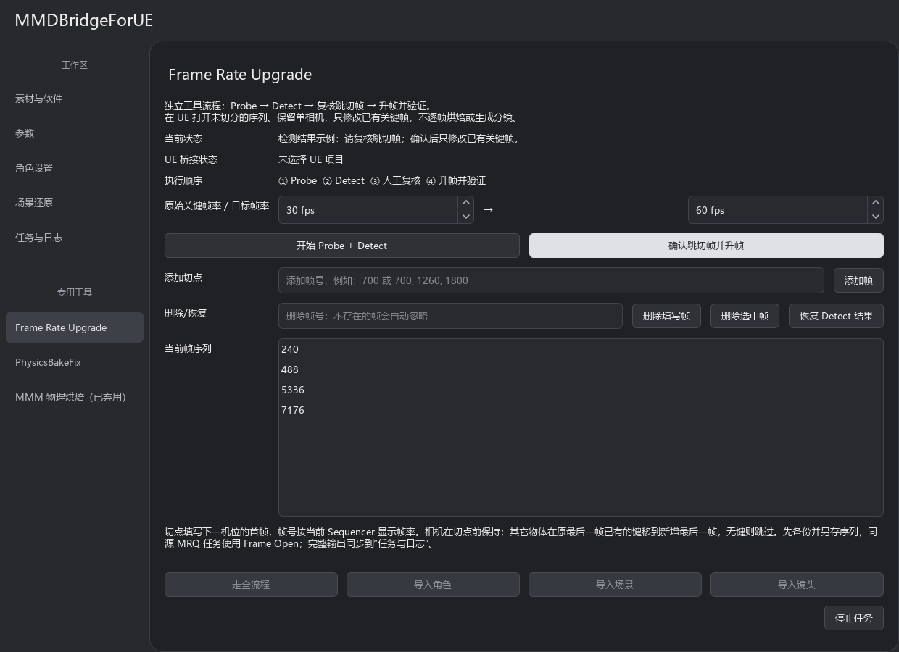

<p align="center"></p>

# MMDBridgeForUE

将 MMD 角色、动作、镜头和 Blender 场景导入 Unreal Engine，继续编辑、打光与渲染。

Windows 桌面工具，支持角色物理烘焙、USD 场景转换、镜头导入和后台渲染。角色、场景与镜头可分别导入，也可一次完成全流程。转换在本地执行，无需在线服务。

**[v0.4.0 更新说明](docs/releases/v0.4.0.md) · [旧版 v0.3.0 下载](https://github.com/BlackLnt-OxO/MMD-Blender-UE5-BridgeAuto/releases/tag/v0.3.0) · [快速上手](docs/QUICK_START.md) · [完整文档](docs/README.md) · [反馈问题](https://github.com/BlackLnt-OxO/MMD-Blender-UE5-BridgeAuto/issues)**

**v0.4.0** 新增六档几何中的两种头发策略、[UE 材质配置复用](docs/CHARACTER_MATERIAL_PRESETS.md)、[三层内置卡通渲染](docs/BUILTIN_CEL.md)及 **Frame Rate Upgrade**。升帧在单相机内保持跳切前的新增半帧，仅后移指定位置已有的物体键，保留 Add 和备份。旧切分脚本继续兼容，界面使用升帧入口。[版本与验证范围](docs/PROJECT_STATUS.md#源码与发行包)。

本页操作说明面向 v0.4.0 源码与本次 Windows 打包批次；本地打包和 Git 推送不会自动替换 GitHub Release 的旧附件。旧下载包以其包内文档为准。后续开发先看 [当前状态](docs/PROJECT_STATUS.md) 与 [AGENTS.md](AGENTS.md)。


*v0.3.0 界面截图，素材路径为示例。[截图说明](docs/images/gui-v0.3.0/README.md)。*

## 快速开始

1. 下载 `MMDBridgeForUE-Windows-x64.zip`，**完整解压**，打开 `MMDBridgeForUE.exe`。普通使用不用另装 Python；不要只复制 EXE。
2. 准备 **Blender 5.2.x、UE 5.8.x**。导入角色还需要 [rintrint/mmdbridge 的 Release 配套程序](https://github.com/rintrint/mmdbridge/releases)，它与本工具的 UE 桥接插件不同。
3. 在 **素材与软件** 中选择软件和 `.uproject`。首次使用工程，先保存并关闭 UE，点击 **安装 UE 桥接插件**，重新打开工程，再点 **连接所选项目**。
4. 填入 **PMX 模型、动作 VMD、Blender 场景**。补充动作 VMD（表情、眼神、口型等，可多选）、镜头 VMD 可选。MMDBridge 安装目录支持 **自动检测**；临时中转目录可留空。
5. 在 **参数** 中确认帧范围和画幅，在左侧 **工作区 → 角色设置** 中确认角色材质。默认使用第二项 **内置PBR角色**；具体要求见 [角色材质](docs/CHARACTER_MATERIALS.md)。
6. 点击 **走全流程**，在 **任务与日志** 查看进度。完成后到 UE 检查关卡、序列和画面。

首次建议用短动作、小场景。只导入一项时，直接用底部的 **导入角色／导入场景／导入镜头**，输入要求见 [快速上手](docs/QUICK_START.md)。

源码版素材页首次默认单角色，之后记住上次选择的模式；点击“多角色”后切换为包含全部角色的模型、动作和补充动作配置表，取消后恢复单角色输入。每个角色的补充 VMD 独立排序，同名轨道由最后一个包含它的文件整轨道覆盖，未出现的轨道保留；合并结果存入对应中转任务。表格只显示文件名，悬停可查看完整路径；附加角色配置会保留，但单角色模式不会使用它们。

程序使用独立 MMDBridge 实例依次烘焙；每位角色只执行一次完整帧段烘焙，不再预烘焙 60 帧样本，分别检测骨骼、还原材质并导出，最后合成同一条 UE 序列，共用场景与镜头。各角色输出隔离，成功后自动删除 AVI；Runtime 按来源版本缓存，后续单角色和多角色任务复用，使用期间独占并检查关键文件完整性。连接 UE 项目时会自动启用所需官方插件，已打开的编辑器需要重启才能加载新启用的插件。

已识别的上游 MMDBridge 版本会在 Runtime 副本中自动修正当前线程 CBT Hook 参数；原安装保持不变。适用版本、修复原理和校验方式见 [Runtime Hook 修复说明](docs/mmdbridge_runtime_hook.md)。

## 主要功能

| 功能 | 说明 |
| --- | --- |
| 角色与物理动画 | PMX、VMD 经 MMDBridge 烘焙，再由 Blender 导出模型和动画双 FBX；支持有序补充动作及多角色独立合并。 |
| Blender 场景 | 导出参考帧的最终几何、修改器与实例，生成 USD 场景，并转换材质、灯光和雾。 |
| VMD 镜头 | 导入 VMD 镜头，生成可在 UE Sequencer 中编辑的镜头轨道。 |
| 材质配置与卡通 | 保存 UE 实际手调参数、按槽位复用与撤销；可选三层 Cel、MatCap 和 A／B 配色。 |
| 镜头升帧 | 检测并复核跳切，保持新增半帧、移动已有键，配置 MRQ Frame Open，另存结果。 |
| 参考图与渲染 | 渲染 Blender／UE 参考帧，生成对照与差分；也能关闭编辑器后使用已保存的 MRQ 预设后台输出。 |
| 任务恢复 | 保存任务、日志和检查点，支持停止后继续处理。 |

## 功能特色

### 常用参数与高级分组

文件路径各占一行；帧率、范围和画幅放在“参数”页，角色材质、散射、光照和几何放在与“场景还原”同级的“角色设置”页，高级参数按用途折叠。角色材质支持 **UE 官方卡通**、**内置PBR角色**、**内置卡通渲染**、**ZZZ_Render_PMX** 和自定义母材质配置。


角色设置独立位于左侧工作区，与场景还原同级；上图为 v0.3.0 旧界面参考。当前六档几何的新任务默认是“焊接＋加权法向，头发仅加权法向、不焊接”，旧任务保留原选择；新增控件见 [卡通渲染](docs/BUILTIN_CEL.md)与[材质配置复用](docs/CHARACTER_MATERIAL_PRESETS.md)。

[角色材质如何选择 →](docs/CHARACTER_MATERIALS.md) · [UE 中各参数如何调整 →](docs/UE_PARAMETERS.md)

### 按物体与材质槽局部调整

在 UE 单选或多选物体，分析其材质槽，按需切换为不透明、镂空遮罩、薄片透光或透射折射。仅更新勾选的槽位，支持撤销，无需重新导入整个场景。该功能适用于能匹配到本工具转换记录的物体。


[操作步骤与写入范围 →](docs/USAGE.md#局部材质切换)

### 物理骨自动修复与镜头升帧

默认角色流程自动检查物理骨的显示枠登记，并按需修复任务中的 PMX 副本。**PhysicsBakeFix** 提供独立检测和修复入口。

**Frame Rate Upgrade** 检测跳切并列出候选帧，确认后在序列副本中保持切前半帧，保留单相机和原 Camera Cut；候选帧支持手动增删。已有分镜不自动改动。



[镜头升帧操作 →](docs/USAGE.md#镜头升帧frame-rate-upgrade) · [物理骨修复 →](docs/USAGE.md#物理骨修复)

## 环境与兼容

- **Windows x64**；发行包自带桌面 Python／Qt 依赖。
- 主流程使用 **Blender 5.2.x + UE 5.8.x**。v0.2.0 可用同一套 Blender 5.2 处理角色与场景，角色适配器也保留 4.3 兼容。
- 发行包包含 **UE 5.8.2 / BuildId 55116800** 的视口与角色插件。引擎 BuildId 不同时，需要为自己的引擎编译相应插件，不用重编 UE。
- 默认角色流程需要外部 MMDBridge；单独转换 Blender 场景不需要。MMD2Unreal、KawaiiPhysics 和 MMM 只用于各自的旧入口。

跨渲染器差异、模拟迁移和显存限制见 [已知问题](docs/KNOWN_ISSUES.md)。

## 文档

| 内容 | 文档 |
| --- | --- |
| 首次导入 | [快速上手](docs/QUICK_START.md) |
| 安装软件、连接 UE、从源码启动 | [安装与启动](docs/INSTALL_WINDOWS.md) |
| 单项导入、配置、修复、升帧和恢复 | [日常操作](docs/USAGE.md) |
| 选择内置 PBR、Cel、官方 Toon、ZZZ 或自定义母材质 | [角色材质](docs/CHARACTER_MATERIALS.md) |
| 保存 UE 材质并用于另一个角色 | [材质配置复用](docs/CHARACTER_MATERIAL_PRESETS.md) |
| 调整 UE 中的皮肤、丝袜、透明、贴图及灯光参数 | [UE 参数含义与调节指南](docs/UE_PARAMETERS.md) |
| 处理几何、材质和碰撞 | [USD 场景](docs/USD_SCENE_TUTORIAL.md) |
| 对照灯光、雾和源色彩 | [场景光影](docs/SCENE_APPEARANCE.md) |
| 设置 MRQ 和后台输出 | [显存与画质](docs/MRQ_MEMORY.md) · [后台渲染](docs/background_render.md) |
| 修改程序或排查数据流 | [源码结构](docs/ARCHITECTURE.md) |

## 从源码运行

安装 Git 和 Windows 64 位 Python 3.12（也支持 3.11），然后执行：

```powershell
git clone https://github.com/BlackLnt-OxO/MMD-Blender-UE5-BridgeAuto.git
cd MMD-Blender-UE5-BridgeAuto
powershell -NoProfile -ExecutionPolicy Bypass -File scripts/setup.ps1
.\.venv\Scripts\python.exe scripts\desktop_entry.py
```

也可以双击仓库里的 `start.cmd`。开发依赖、检查与打包方法见 [安装说明](docs/INSTALL_WINDOWS.md#开发与打包)。

反馈问题时，附上版本、操作步骤、预期与实际结果，以及相关任务日志；画面问题最好同时附 Blender 和 UE 的同帧截图。请勿上传无权公开的素材。

源码采用 **GPL-3.0-or-later**，见 [LICENSE](LICENSE)。第三方组件与配套资产的来源、许可见 [THIRD_PARTY.md](THIRD_PARTY.md)，模型、动作和场景由使用者自行准备。

## 内置PBR角色

新任务默认使用角色预设列表第二项“内置PBR角色”，支持皮肤、眼睛、各向异性头发及通用 PBR；MatCap 跟随原 PMX，支持逐材质槽修正和 UE 局部应用／撤销。输入、白模回退和测试方式见 [角色PBR说明](docs/CHARACTER_PBR.md)。
