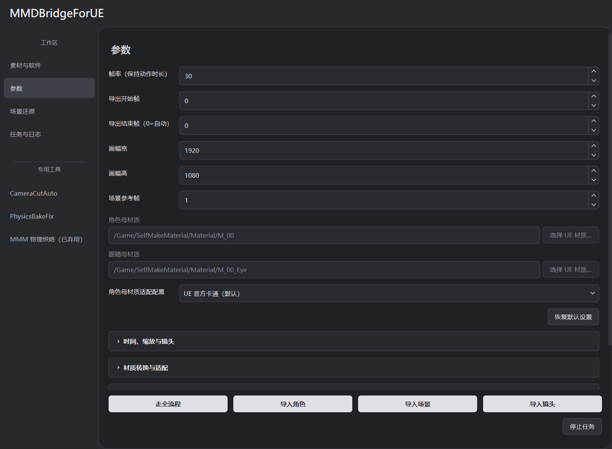

# 角色材质

“参数 → 角色母材质适配配置”控制 PMX 材质的创建与绑定，独立于 Blender 场景的材质工作流。



## 配置选择

| 配置 | 何时使用 | 转换依据 |
| --- | --- | --- |
| UE 官方卡通（默认） | 使用 UE 官方 Substrate Toon | 工具创建 Toon 母材质与实例，不使用自选母材质路径 |
| ZZZ_Render_PMX | 使用配套 ZZZ 材质与描边 | 已登记父材质、参数契约、PMX 数据和部位规则 |
| 自动按母材质匹配 | 已有自己的 UE 母材质 | 用完整资产路径匹配登记配置；没有专用配置时走通用映射 |
| 仅通用参数匹配 | 只需要按常见参数名称绑定 | 角色主体不采用专用适配；眼睛仍单独匹配 |

新任务默认官方卡通。缺少该字段的旧任务／旧预设按 `auto` 读取，避免改变既有任务；自定义配置 id 支持载入和保存，菜单仅允许选择已有项。

## UE 官方卡通

工具通过 `SubstrateToonBSDF` 和 `ToonProfile` 建立母材质，再绑定 PMX 基础图、颜色等输入。角色和眼睛母材质路径值会保留，但输入框禁用。

目标项目必须有可用的 Toon API，并满足：

```text
r.Substrate=1
r.Substrate.ProjectGBufferFormat=0
```

不满足时明确报错，不自动改成 PBR，也不自动修改项目 Substrate 配置。项目配置需手动修改并重启 UE 生效，调整前确认对其它材质与渲染设置的影响。

旧 `auto`／`generic` 路线在自选母材质不存在时保留既有回退：可用时用官方 Toon，否则使用工具 PBR。显式选择官方卡通时，不兼容则停止。

## ZZZ_Render_PMX

内置配置见 [ZZZ_Render_PMX.json](../profiles/character_materials/ZZZ_Render_PMX.json)，登记父材质为 `/Game/Character/MasterMaterial/M_RenderMaster`。工具安装原模板及依赖，在任务管理的复制品上适配，不改写原材质，也不覆盖目标工程里同路径但内容不同的资产。

选择 ZZZ 时，仍是通用默认值的角色路径会换成模板路径，默认眼睛路径清空以使用配置里的眼部母材质。已经明确自选的路径保留。

### 贴图映射与部位识别

- 基础图映射到 `BaseTex`，没有引用基础图时使用白图乘 PMX 材质颜色。
- 部位由 PMX 中英文材质名和配置正则规则识别，包括面部、皮肤、头发、眼睛及三组衣服。
- 附带贴图只在已登记用途且唯一匹配时绑定，多候选或用途不明只报告。
- 缺少 Lightmap 时按部位和 sphere 模式生成常量控制图；缺少 MN 使用 `[0,0,1,0]`。
- 源文件明确引用的贴图丢失会报告缺失，中性图不能恢复原花纹或透明裁切。

ZZZ 母材质的 Lightmap.R 使用 Skin=0、Cloth1=98/255、Cloth2=18/255、Cloth3=181/255。G 是第一组 Matcap 权重，B×A 是第二组，A 不是透明度；AO 位于 MN.B。PMX sphere 模式按槽保留，附加 UV 的 subtexture 不能直接当普通 Matcap。默认明暗使用母材质的三色／Ramp，PMX Toon 数据继续保留供其它配置使用。

工具自动生成 Lightmap 的衣服槽，会归一化 Cloth Ramp 的亮面强度，避免源专用深灰再次乘到 PMX 基础图上。`Ramp_Cloth_1/2/3_LitGain` 可调整，设为 `[1,1,1]` 恢复原曲线强度；用户自带 Lightmap 不自动归一化。面部 ShadowColor 默认 HSV V=0.2。

### 眼睛、透明和描边

眼睛路径留空时，ZZZ 的 `default_eye_parent` 用于眼睛、眼白和瞳孔，眉毛与睫毛不归入眼球。默认 ShadowColor=0.65、TransitionColor=0.85，保留自发光；源图的黑瞳不会被洗白。用户明确自选的眼睛材质保持原样。

Alpha 按材质实际使用的 UV 采样，包括重复寻址与零面积 UV 三角形。裁切、渐变透明和 PMX 材质 Alpha 分别保留；半透明自发光也乘 Alpha。生成实例启用骨骼网格与 MorphTargets usage，不改源母材质。

启用 outline 的配置生成 `/Game/Character/MMDBridge/<任务>/BP_Character`：两层组件引用同一个 SkeletalMesh，分别绑定主材质与描边材质。MainAnimation／OutlineAnimation 默认相同，在 Sequencer 中各有同起止帧的动画轨道，不使用 LeaderPose。

描边使用 `M_OutLine` 副本，参考 PMX 的描边开关、宽度与颜色。默认 scale/face_scale 为 0.1/0.04 厘米；描边层不投影、不碰撞。全部 PMX 材质关闭描边时，会使用按部位排除眼、眉、睫毛、口腔等面片的默认黑描边，并报告回退。当前按材质槽控制宽度，尚未把每顶点 edge scale 写入遮罩，薄表面与特殊法线需要复核。

默认 `sdf.format=none`，不生成面部 SDF、不启用分支，也不创建面部方向组件。实验说明放在 [SDF 技术附录](advanced/CHARACTER_SDF.md)。

## 自定义母材质

角色／眼睛路径使用 `/Game/...` 资产路径。`auto` 以完整父材质路径查找 JSON：唯一匹配使用专用适配，无匹配走通用参数，多重匹配报错。`generic` 主体只按参数及别名映射；可选参数缺失会警告，基础色贴图参数缺失会报错。

“材质转换与适配 → 母材质配置目录”存放用户映射 JSON，内置配置自动读取。默认目录为 `%LOCALAPPDATA%/MMDBridge/material_profiles`。

配置示例：

```json
{
  "version": 1,
  "id": "MyShader",
  "parents": ["/Game/MyShader/M_Character"],
  "required": ["ColorMap", "ControlMap"],
  "textures": {
    "base_color": {"parameter": "ColorMap", "color_space": "srgb"},
    "control": {"parameter": "ControlMap", "color_space": "data"}
  },
  "vectors": {"diffuse_color": {"parameter": "ColorTint"}},
  "scalars": {"opacity": {"parameter": "Alpha"}},
  "packed_textures": {"control": {"channels": {
    "r": {"value": 0}, "g": {"value": 0},
    "b": {"source": "ao", "channel": "g", "invert": true},
    "a": {"value": 1}
  }}},
  "source_rules": [{"semantic": "ao", "pattern": "{base}_AO\\.png"}],
  "sdf": {"format": "none"}
}
```

`textures/scalars/vectors/switches` 声明语义与参数名；`required` 是必须存在的参数。`packed_textures` 逐通道声明来源、反转和比例，示例把 AO 的 G 反转后写入控制图 B。`{base}` 是基础图文件名主体。

`role_rules` 识别部位，`role_presets` 直接声明 default 和各部位的参数值，部位覆盖 default，例如 `{"skin":{"scalars":{"Roughness":0.6}}}`。控制图使用线性 RGBA8，距离图使用 R16F；不要把数据贴图按 sRGB 解读。

## 插件与重新生成

ZZZ 双网格蓝图依赖 **MMDBridgeCharacter Runtime 插件**，即便关闭 SDF 也需要。无 outline 的自选配置保留单网格路线。

发行包原生插件匹配 UE 5.8.2 / BuildId 55116800。其它引擎构建需用实际 UE 的 `RunUAT.bat BuildPlugin` 构建 `plugins/unreal/MMDBridgeCharacter/MMDBridgeCharacter.uplugin`，将 Binaries 放回插件目录，再经 GUI 安装；不能跨 BuildId 复用 DLL。

缓存记录输入、配置、生成设置和母材质依赖。改配置后重新生成角色，避免把旧 Blender 数据绑定到新通道契约。导入后重点检查眼睛、透明面片、衣服明暗与描边。
