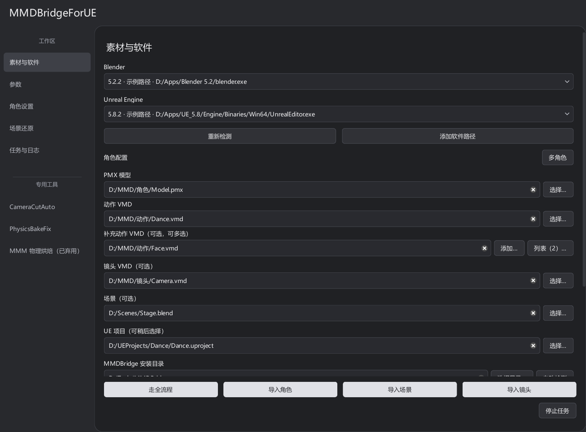
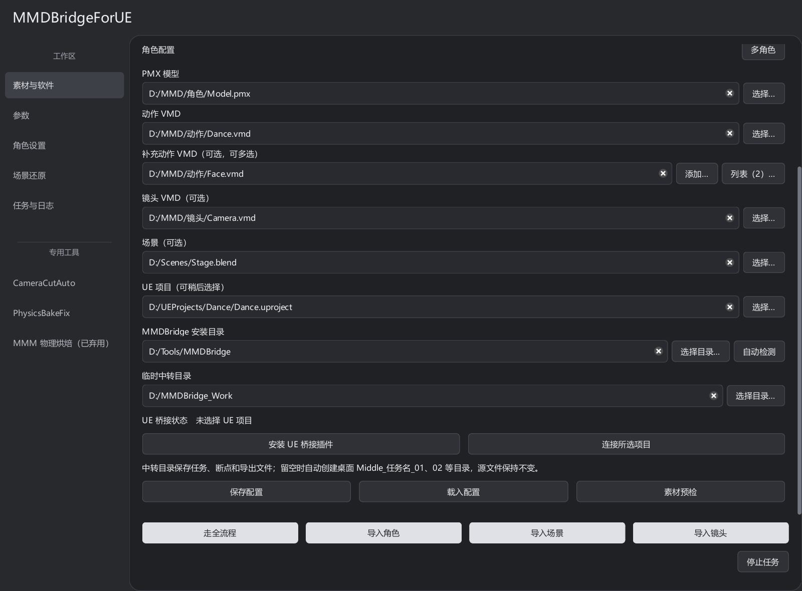
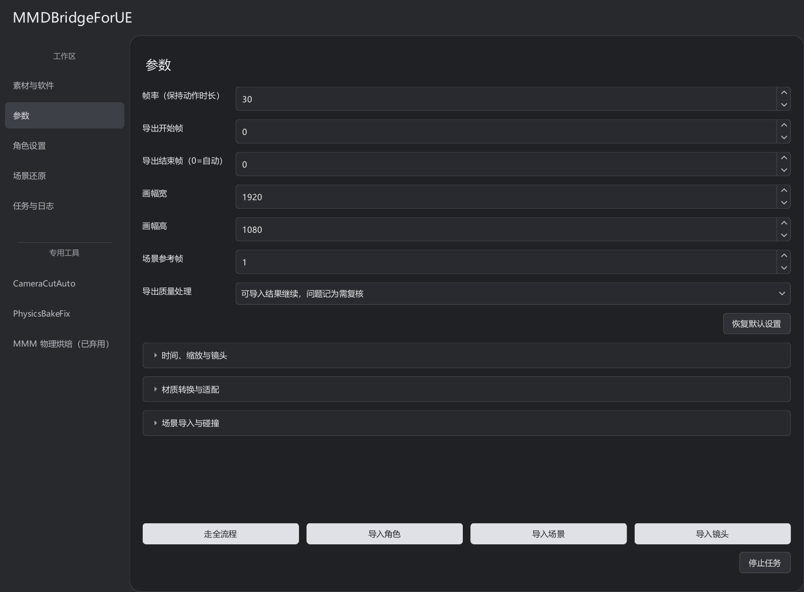
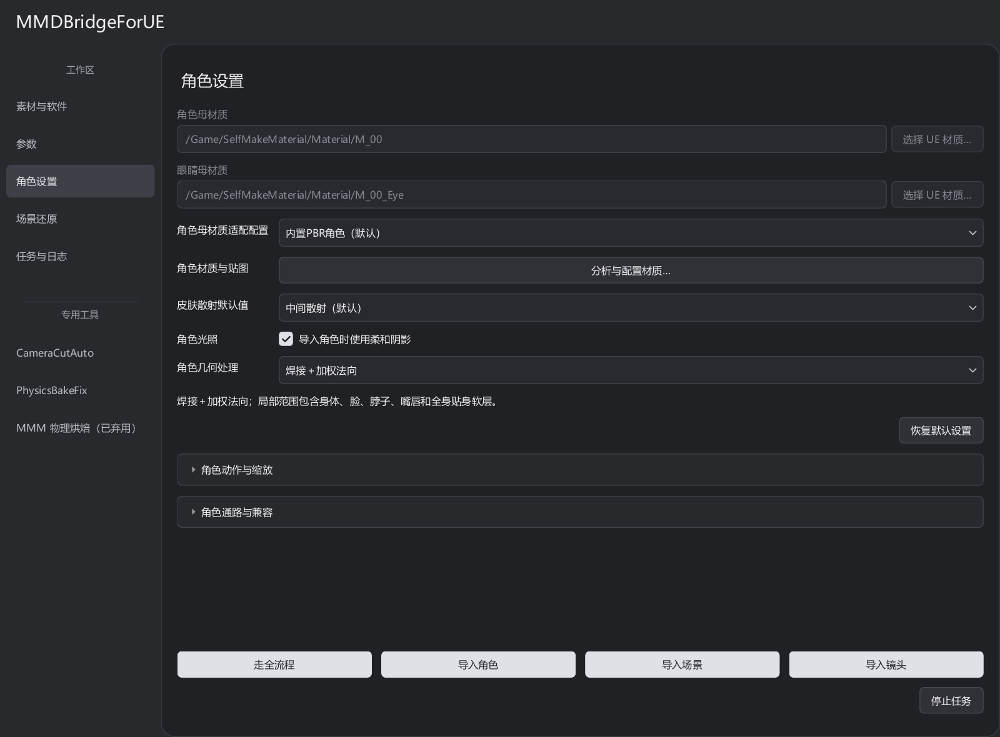
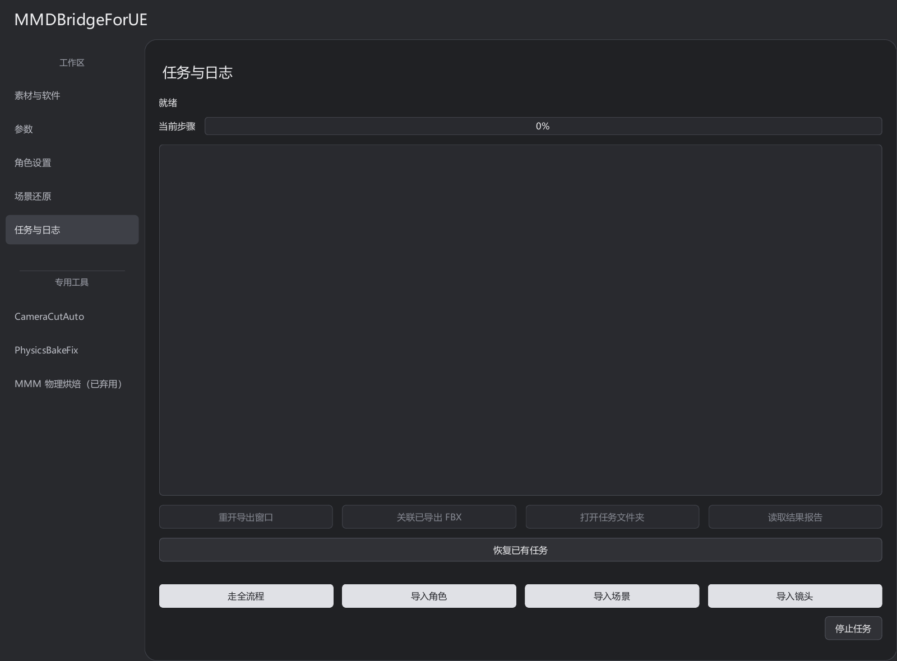

# 快速上手

本教程以角色、动作和 Blender 场景的全流程导入为例。首次建议使用短动作和小场景。

本教程按 v0.3.1 源码与 Windows 打包批次说明，新增六档几何、材质配置复用、内置 Cel 和镜头升帧；通用流程截图保留 v0.3.0 参考，新增功能以当前文字和对应说明为准。旧包以包内文档为准，升级方式见 [安装与启动](INSTALL_WINDOWS.md)，构建区别见 [当前状态](PROJECT_STATUS.md#源码与发行包)。

## 准备素材与环境

| 项目 | 要求 |
| --- | --- |
| 软件 | Blender 5.2.x、UE 5.8.x、上游 rintrint/mmdbridge 配套程序 |
| UE 工程 | 自己的 `.uproject`，能正常打开；内置PBR角色使用桌面 Substrate 渲染路径 |
| 角色 | PMX 与它引用的贴图、一个动作 VMD |
| 场景 | 能在 Blender 正常打开的 `.blend`，贴图和必要缓存齐全 |
| 可选 | 补充动作 VMD（表情、眼神等，可多选）、镜头 VMD |

软件安装和上游目录结构见 [安装说明](INSTALL_WINDOWS.md)。下载 Windows 压缩包后完整解压，打开 `MMDBridgeForUE.exe`；不要单独移动 EXE。

## 1. 连接 UE 工程

在 **素材与软件** 里确认 Blender、Unreal Engine 的程序路径。没有检测到时点击 **添加软件路径**。

首次使用或更新桥接时，选择已有 `.uproject`，保存并关闭 UE，点击 **安装 UE 桥接插件**。重新打开工程后，点击 **连接所选项目**。

UE 的 USD、OpenColorIO、MovieRenderPipeline 是官方插件，本工具的 MMDBridge 系列插件负责导入与交互。原生插件必须匹配引擎 BuildId，提示不匹配时按 [插件编译说明](INSTALL_WINDOWS.md#ue-插件与-buildid) 处理。

## 2. 填写素材和中转目录

- **PMX 模型、动作 VMD、场景**：全流程都要填写。
- **补充动作 VMD、镜头 VMD**：需要才填。补充动作可多选并调整顺序；同名轨道由最后一个包含它的文件整轨道覆盖，未包含的轨道保留。合并文件保存于对应角色任务的 `motion_inputs/merged.vmd`。
- **MMDBridge 安装目录**：选择包含 `MikuMikuDance_CHS.exe` 的上游配套程序目录，或点击 **自动检测**。
- **临时中转目录**：保存任务、断点和导出文件。留空会在桌面创建独立的 `Middle_*` 目录。

各输入框独立记忆路径；自动检测未找到安装目录时，手动指定。

## 3. 确认参数

在 **参数** 页确认帧率、帧范围、画幅和场景参考帧，在同属左侧工作区的 **角色设置** 页确认角色材质与几何：

- 帧率按输出需要设置，默认 30；导出结束帧为 0 时自动确定。
- 确认画幅宽高，以及决定场景静态几何状态的参考帧。
- 角色材质默认选择第二项 **内置PBR角色**。此模式自动创建材质，所以角色／眼睛母材质输入框不可编辑；要用 ZZZ 或自己的母材质，再切换下面的适配配置。

在“角色设置”页选择“角色几何处理”，新任务默认“焊接＋加权法向，头发仅加权法向、不焊接”。六档保留原选择及旧任务含义；“头发不添加修改器”档另行保留原头发法线。局部／全部件一级细分分别提示约2倍／约5倍顶点，六档均处理已确认的共面 Logo。局部范围需要补选时先确认，再启动外部工具。见 [六档说明](CHARACTER_PBR.md#六档角色几何处理)。

需要三层卡通时选择 [内置卡通渲染](BUILTIN_CEL.md)，滤镜母版使用 Before DOF；复用已在 UE 手调的角色外观时使用 [保存、应用及导入时复用材质](CHARACTER_MATERIAL_PRESETS.md)。两者都需安装本批桥接插件，已运行的 UE 保存后重启。

时间偏移、缩放、材质转换和碰撞位于高级折叠组，首次可保留默认值。官方 Toon 的项目要求见 [角色材质](CHARACTER_MATERIALS.md#ue-官方卡通)。

## 4. 启动与检查

点击底部 **走全流程**，在 **任务与日志** 查看进度。角色导出期间保持 Windows 登录、桌面未锁定。

任务结束后，点击 **打开任务文件夹** 查看导出文件和报告。在 UE 播放序列，检查角色物理、材质与镜头，并核对场景灯光、雾和色彩。

失败项和需复核项记录在任务报告中。原始 PMX 和 Blender 场景不覆盖保存。

## 独立导入

| 按钮 | 填写的素材 | 另外准备 |
| --- | --- | --- |
| 导入角色 | PMX、动作 VMD；补充动作可选、可多选 | 上游 MMDBridge、Blender、UE 和工程 |
| 导入场景 | `.blend` | Blender、UE 和工程 |
| 导入镜头 | 镜头 VMD | Blender、UE 和工程 |

三个按钮只处理对应素材。已有 30 fps 镜头需要升至 60 fps 时，到独立的 **Frame Rate Upgrade** 页面检测并确认跳切；工具备份并另存结果，保留单相机、Add 及既有分镜。具体规则与 MRQ 设置见 [镜头升帧](USAGE.md#镜头升帧frame-rate-upgrade)。

## 保存配置与恢复任务

**保存配置／载入配置**复用路径和参数；**恢复已有任务**继续原转换任务。恢复时需保留任务目录、源素材和 UE 工程，源文件变动后另建任务。

遇到问题先看 [已知问题](KNOWN_ISSUES.md)；操作细节见 [日常操作](USAGE.md)。

导入后需要在 UE 调整皮肤、丝袜、透明、贴图或灯光时，见 [UE 参数含义与调节指南](UE_PARAMETERS.md)。
