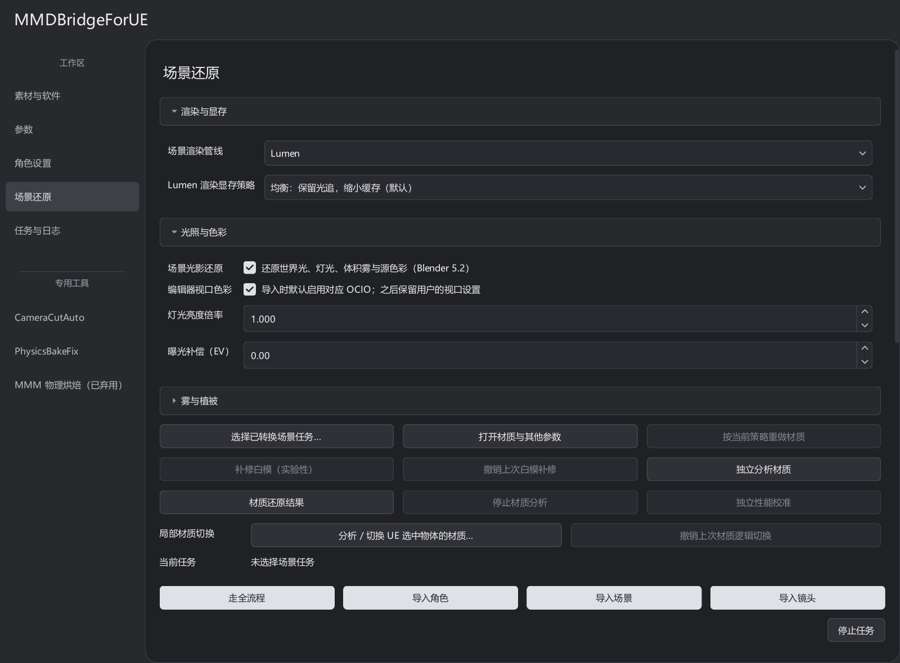

# 灯光、雾与参考图

比较 Blender 与 UE 画面前，先统一相机、参考帧、曝光和色彩配置。

UE 材质、灯光与输出字段的含义见 [UE 参数指南](UE_PARAMETERS.md#灯光场景材质与输出)；本页说明转换和画面对照流程。

## 光影参数

“场景还原”把 **渲染与显存、光照与色彩、雾与植被**分组折叠。新场景默认启用光影还原，使用 Lumen 和原生体积雾；旧任务恢复时沿用保存的配置。

| 参数 | 影响 |
| --- | --- |
| 灯光亮度倍率 | 在源灯光的转换结果上调整亮度 |
| 曝光补偿 | 调整画面曝光，单位 EV |
| 雾密度倍率 | 调整源雾转换后的密度，不改变栅格精度 |
| 编辑器视口色彩 | 导入时默认设置对应 OCIO，之后保留用户的视口修改 |
| 世界雾渲染方案 | 默认原生体积雾；其它异质体积选项带有实验性限制 |

光影参数在重新导入场景后生效；切换渲染管线复用原资产。

## 原生雾和路径追踪

Lumen 下默认使用原生体积雾，实时计算灯光注入、遮挡和散射，并保留源雾密度与边界作为转换输入。

路径追踪恢复源雾表达作为对照。两者在彩色消光、多介质、多次散射、细结构和玻璃作用上可能不同。原生雾不自动模拟玻璃透镜折射后的聚光。

SVT 异质体积方案为实验选项，部分配置资源开销较高；常规使用建议保留原生雾。质量参数的开销见 [显存与画质](MRQ_MEMORY.md)。

## 生成参考图

1. 在 Blender 设置活动相机、画幅、参考帧，保存源文件。
2. 在工具选择已转换的场景任务，或完成一次场景导入。
3. 点 **渲染 Blender 参考帧**。
4. 选择 Lumen 或路径追踪，点 **渲染 UE 参考帧**。
5. 点 **生成对照与差分**，打开原图检查几何、材质、光影和构图。

导入生成的 MRQ 配置使用 Blender 输出画幅，当前默认 30fps；需要其它输出设置时检查并保存 UE 预设。**复制 MRQ 配置路径**可取得当前任务对应的配置，手动 MRQ 时要加载完整配置，仅添加序列不会自动应用全部色彩设置。

页面按实际渲染回执显示最新结果。切换管线后需重新渲染，才能生成对应的参考图与差分。

## 视口与输出不一致时

检查是否使用同一个相机、帧号、OCIO 和 MRQ 配置。同一个世界同时开 Lumen 与 PT 视口时，当前雾可见性不能分别保持；先用一个活动视口切换，再检查正式输出。

后台渲染使用已保存的关卡与序列，步骤见 [后台渲染](background_render.md)。玻璃和体积限制见 [已知问题](KNOWN_ISSUES.md)。
