# UE 参数含义与调节指南

本页介绍本工具导入后在 UE 中常见的材质、贴图、灯光和渲染参数，重点是**内置 PBR 角色**。依据 v0.3.0：分类 v9、着色 v11、默认 v6、Alpha 接线 v1。旧 v0.2.0 EXE、旧任务和自选母材质可能没有相同参数；以当前材质的 Parent 和实际节点连接为准。版本区别见 [源码与发行包](PROJECT_STATUS.md#源码与发行包)。

## 从哪里开始调

在关卡中选中角色，找到 Skeletal Mesh 组件的 Materials，打开目标槽正在使用的 `MI_` 材质实例。不要仅凭内容浏览器中的相似名称判断正在使用哪个材质。多角色的材质分目录存放；一次只调一个角色的一个槽。

`MI_` 是实例，`M_` 是母材质，`T_` 是贴图，`SSP_` 是皮肤散射配置。参数左侧勾选框表示“覆盖父级值”，未勾选时继承父级；右侧复位箭头也恢复父级值，未必等于该角色导入时的逐槽值。先记录原值或复制实例，并检查复制品已经绑定到目标槽。基本操作见 [UE 材质实例说明](https://dev.epicgames.com/documentation/unreal-engine/creating-and-using-material-instances-in-unreal-engine?application_version=5.8)。

下表给出常见目标的入口，后文再解释全部内置 PBR 配置参数。数值范围是程序允许的配置范围；UE 中手工输入不一定受同样限制。默认值指新配置，实际实例还受材质类型、PMX 透明度、贴图和显式覆盖影响。

例图按参数放在对应段落中。基础几何图使用独立 UE 工程和当前母材质，每组固定机位、灯光与曝光，只改变注明的设置；不作为真实模型外观验收。**丝袜厚度与 Translucent 图中复现了半透明受光偏黑，已标为异常复现，不代表正常外观。** 皮肤双层高光另有明确注明旧默认值的角色实测图。图片均保留原生输出，点击可看原尺寸；[图片来源与固定条件](images/ue-parameters/README.md)。

| 想调整什么 | 先看哪里 |
|---|---|
| 整体颜色、白色衣服偏色 | `base_color_Tex`、`BaseColorTint`，再查 MatCap 与灯光 |
| 表面太亮、像塑料 | `Roughness`、`Specular`、`DetailStrength` |
| 皮肤粉嫩度 | `SkinRosiness`，默认 0.35 |
| 皮肤散射、鼻部细节 | `SSSStrength`、面部遮罩和关联的 `SSP_` |
| 皮肤高光范围与柔和度 | `SSP_` 的 Dual Specular，见 [皮肤高光](#皮肤高光) |
| 丝袜薄厚 | 半透明丝袜母材质中的 `HosieryThickness` |
| 裙摆、蕾丝、发片镂空 | 基础图 A、`Opacity`、Masked 和最终 Opacity Mask 连接 |
| 改成半透明后受光不同 | 母材质的 Translucency Lighting Mode 与实际着色节点 |
| 贴图导入后变灰、变亮 | Source Color Settings、纹理 `sRGB`、预览通道 |

## 基础色、反射和细节

| UE 参数 | 含义与调节效果 | 范围与适用条件 |
|---|---|---|
| `BaseColorTint` | 乘到基础图 RGB 上的颜色。白色保持图中颜色；有基础图时通常为白色，无图时可来自 PMX 固有色 | RGB；这里的 A 不控制透明度 |
| `Roughness` | 表面粗糙度。降低通常让反射更集中，提高让反射更分散 | 0.02—1；`Use_roughness=1` 时由贴图代替基础标量，仍可叠加细节与水渍 |
| `Specular` | 非金属表面的镜面反射控制，不是曝光或自发光 | 0—1；身体／面部默认 0.42／0.35 |
| `Metallic` | 金属响应，改变反射与漫反射的分配 | 0—1；金属类型默认 1，其它通常 0；`Use_metallic=1` 时读取贴图；皮肤 Profile 不按普通金属表面解释 |
| `AO` | 没有 AO 图时的环境遮蔽输入；1 不额外压暗，降低可增加遮蔽 | 图中默认 1；`Use_ao=1` 时读取 AO 图，最终效果还取决于渲染管线 |
| `DetailStrength` | 内置微法线叠加强度；0 关闭这层细节，保留原基础法线 | 0—1；身体／面部默认 0.065／0.04 |
| `DetailTiling` | 微法线和细节粗糙度的 UV 重复次数；越大纹理越密、单个纹理越小 | 1—300；丝袜默认 135，也参与丝袜编织遮罩采样；准备时可能按表面校准 |

基础法线 `normal_Tex` 与微法线 `detail_normal_Tex` 是两层输入。把 `DetailStrength` 改为 0 不会关闭原模型法线。标量粗糙度也不一定等于最终逐像素粗糙度，应同时检查贴图开关、细节和水渍。UE 的通用物理输入含义见 [Material Inputs](https://dev.epicgames.com/documentation/unreal-engine/material-inputs-in-unreal-engine?application_version=5.8)。

### 粗糙度例图

同一通用 PBR 球体，仅改 `Roughness`；没有粗糙度贴图和微法线干扰。观察反射亮带从集中到分散的变化。粗糙度不是整张图的亮度倍率。

| 0.08 | 0.40 | 0.85 |
|---|---|---|
|  | 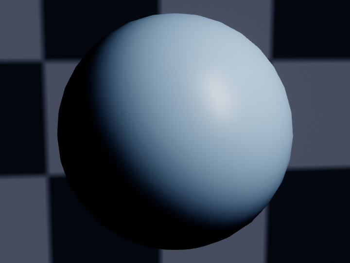 |  |

## 皮肤颜色与散射

| UE 参数 | 含义与调节效果 | 范围与适用条件 |
|---|---|---|
| `SkinRosiness` | 在原基础色与暖粉色乘算结果之间混合。0 保留原基础色，增大时暖粉色影响更强 | 0—1；面部与所有皮肤默认均为 0.35；不增加自发光 |
| `SkinRosyTint` | 暖粉色乘算的 RGB 颜色 | 当前母材质默认 `(1.04, 0.25, 0.5)`；配合 `SkinRosiness` 使用，旧母材质默认不同 |
| `SSSStrength` | 皮下散射贡献。降低可减少散射造成的柔化，不直接改变网格和基础图 | 0—1；中间散射的身体／面部默认 0.35／0.27；用于非半透明皮肤／面部 |
| `SSSDetailPreservation` | 面部散射遮罩的参与强度。0 忽略遮罩，1 完整使用遮罩；遮罩较暗区域会减少散射 | 0—1，默认 1；仅面部且 `Use_sss_mask=1` 有效，不是几何锐化 |
| `SSSMaskFloor` | 程序生成面部散射遮罩的下限；提高可避免鼻部等区域的散射被压得过低 | 0—1，默认 0.9；只对 `GeneratedSSSMask=1` 的自动遮罩生效 |
| `GeneratedSSSMask` | 标记当前遮罩是否由程序生成，用于启用上述下限 | 自动设置为 0 或 1；手工遮罩通常为 0，避免改变手绘黑白含义 |
| `SubsurfaceTint` | 母材质的 SubSurfaceColor 兼容输入 | 它不替换 `SSP_` 的 Mean Free Path Color；不要只改此参数判断散射配置是否已改变 |

面部遮罩改变的是散射强度分布。`SSSMaskFloor` 不会把 Base Color 变白，也不控制材质镂空。皮肤节点的 Opacity 用作散射贡献，而表面裁切使用最终输出的 Opacity Mask，二者要分别检查。[UE Subsurface Profile](https://dev.epicgames.com/documentation/en-us/unreal-engine/subsurface-profile-shading-model-in-unreal-engine) 也说明了 Profile 的散射遮罩与实例覆盖方式。

### 粉嫩度与散射例图

第一组只改 `SkinRosiness`。0 为原基础色，0.35 为当前默认，0.8 用于展示较强的暖粉色影响，不是推荐所有模型都使用的数值。

| 0 | 0.35（当前默认） | 0.8 |
|---|---|---|
| 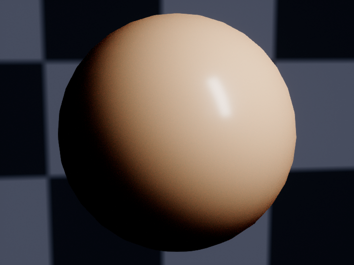 |  | 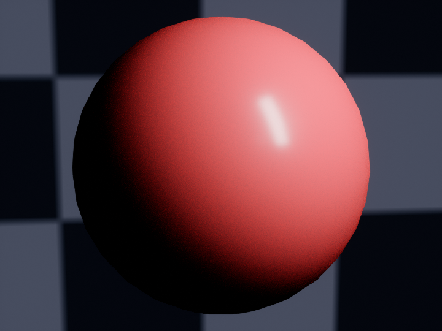 |

第二组只改 `SSSStrength`，固定中间散射 Profile 和粉嫩度 0.35。关注受光与阴影的过渡；散射还会影响 Profile 的高光响应，不等于把基础色统一调红。

| 0 | 0.35（身体默认） | 1 |
|---|---|---|
|  | 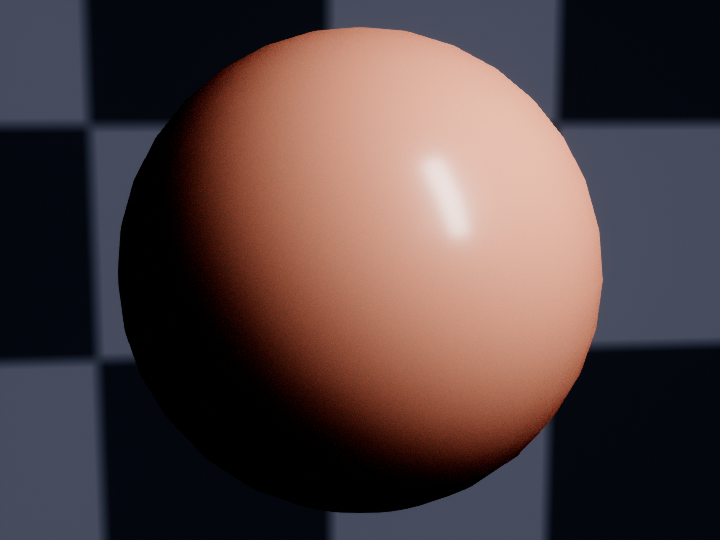 |  |

### 皮肤高光

程序中的三个高光参数写入每槽专属的 `SSP_` 配置，**不作为同名实例标量保存**。在皮肤实例 Details 找到 **Override Subsurface Profile**，打开已关联的配置，在 **Dual Specular** 中调整。着色 v11 的非半透明皮肤／面部使用这套控制。

| 程序参数 | 程序范围；身体／面部默认 | UE 配置中的对应含义 |
|---|---|---|
| `SkinHighlightWidth` | 0.5—2；0.6／0.85 | Roughness 0，主高光粗糙度倍率；增大通常扩大主高光 |
| `SkinHighlightSoftness` | 0—1；0.5／0.4 | 决定 Roughness 1：`Width + (2 - Width) × Softness`；增大扩展外围高光 |
| `SkinHighlightBlend` | 0.1—0.9；0.45／0.65 | Lobe Mix，第二层高光的混合占比 |

UE 再将 Profile 的粗糙度倍率与表面粗糙度结合。高光形状还受 `Roughness`、`Specular`、灯光尺寸和观察角度影响，不能把范围倍率当作屏幕像素半径。散射贡献很低时，双层高光也可能逐渐淡出。

| `SSP_` 中的字段 | 含义 | 当前新配置 |
|---|---|---|
| Enable Burley／Enable Mean Free Path | 选择当前使用的散射表示 | 均开启；不要为了改肤色随意切换算法 |
| Surface Albedo | 散射模型的表面反照率颜色 | 中间散射 `(0.8, 0.62, 0.56)` |
| Mean Free Path Color | 各颜色分量的散射距离比例 | 中间散射 `(1, 0.55, 0.435)` |
| Mean Free Path Distance | 散射距离尺度 | 面部 0.18 cm、身体 0.32 cm；增大需检查鼻翼、唇线等细节 |
| World Unit Scale | 散射计算的世界单位尺度 | 程序写入 1；模型单位错误应先修复单位，避免用此字段掩盖 |

原暖色配置与当前中间散射的区别见 [柔和阴影与皮肤散射](CHARACTER_PBR_SOFT_SHADOW.md)。编辑共享 `SSP_` 会影响所有引用它的材质；只调一个槽时，先确认是否为该槽的独立高光配置。

下面是已完成的 UE 5.8.2 单参数实测图，点击图片可看 1440×1440 原图。四张均为相同机位、姿态、条形光与曝光；腿部 `Roughness=0.34`、`Specular=0.42`，只改变表中一个高光控制。观察腿上纵向亮带的范围和外围过渡，不要把其它部位的静态颜色误认为参数变化。

| 基准：Width 0.6／Softness 0.5／Blend 0.45 | 仅 Width → 1.5 |
|---|---|
|  |  |

| 仅 Softness → 1.0 | 仅 Blend → 0.85 |
|---|---|
|  | 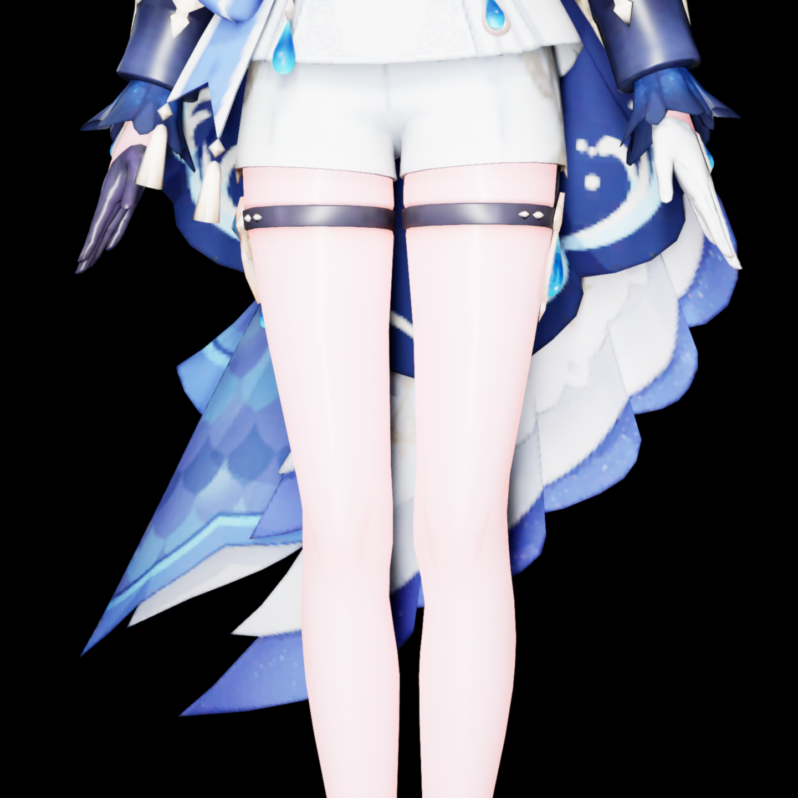 |

这组图来自 2026-10-23 着色 v11／默认 v5 的同条件实验：身体粉嫩度 0.55、面部 0.45，**不是当前统一 0.35 默认的肤色展示**。高光控制公式沿用，肤色与最终风格仍取决于模型和灯光。角色模型提供：miHoYo；模型改造：观海。原图来源与参数见 [例图说明](images/ue-parameters/README.md)。

## 布料、缎面、头发与丝袜

| UE 参数 | 含义与调节效果 | 范围与适用条件 |
|---|---|---|
| `Fuzz` | 布料纤维绒光贡献，增大通常加强边缘纤维感 | 0—1；Cloth 类型默认 0.7；接到节点的 Fuzz Amount |
| `FuzzBrightness` | 将纤维颜色从基础色向白色提亮，帮助深色布料保留纤维光泽 | 0—1，默认 0.08；不是整个材质的曝光 |
| `FabricRoughnessVariation` | 细节图对粗糙度的局部扰动幅度；增大使纹理区域的光滑差别更明显 | 0—0.5；布料默认 0.22，缎面 0.16 |
| `Anisotropy` | 控制方向性反射；0 为各向同性，正负值改变响应方向 | -0.95—0.95；用于头发、缎面和丝袜，仍需切线与灯光支持 |
| `HairDirection` | 旋转头发反射切线方向；有流向图时在图中方向基础上旋转 | -360—360°，默认 90°；流向图的默认零偏置对应 90° |
| `FabricDirection` | 旋转缎面／丝袜的切线方向 | -360—360°，默认 90°；不旋转基础色图案 |
| `HosieryCoverage` | 标准厚度下的编织覆盖密度；越大通常越不透 | 0—1，默认 0.5；仅半透明丝袜母材质 |
| `HosieryEdgeDensity` | 斜视角时的覆盖增强；0 不增加这种角度效果，1 使用完整角度效果 | 0—1，默认 1；不是黑色边缘描线 |
| `HosieryThickness` | 对标准厚度的覆盖结果作线性缩放，最后限制到 0—1 | 0—3，默认 1；0 隐藏丝袜层，薄／中／厚预设为 0.35／1／2.5 |

丝袜厚度是**无单位的视觉覆盖倍率**，不增加网格厚度、不改变基础 RGB。基础图 A、PMX 透明度、独立透明图和覆盖密度会共同限制结果，因此设为 3 也不保证每个像素都完全不透。丝袜母材质必须在创建时使用半透明分支；把 Opaque 实例改成 Translucent 不会自动补出厚度计算节点。

白色丝袜变厚后偏黑，先核对基础图 RGB、`BaseColorTint`、MatCap、反射环境和受光，再看透明模式。增厚会让丝袜层自身的颜色与光照贡献更明显；仅凭变暗现象不能确定是哪项造成。材质预览球使用独立的灯光、背景和模型，也不能代替角色所在关卡的判断。

### 丝袜厚度例图

**异常复现，待复核：** 内层是固定的皮肤球体，外层基础色设为白色的半透明丝袜球壳；只改 `HosieryThickness`。固定 `Opacity=0.8`、`HosieryCoverage=0.5` 和 `HosieryEdgeDensity=1`，没有 MatCap。本次 SceneCapture2D 中白色外层随增厚变黑，不应将这组当作白色丝袜的正常效果或通用颜色规律。

| 0.35（薄） | 1（中） | 2.5（厚） |
|---|---|---|
| 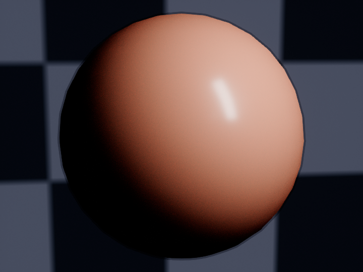 | 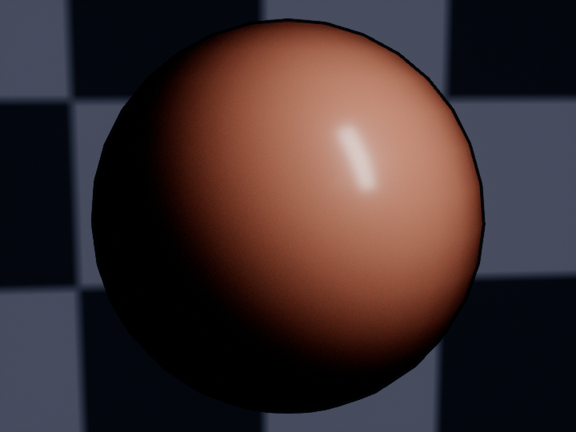 | 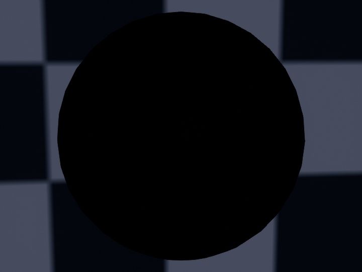 |

改用 Movable 灯光的独立复核仍出现偏黑；尚未定位根因，也未用正式 MRQ 重验这一组。厚度只缩放覆盖的代码含义保持不变，实际受光问题另外记录在 [已知问题](KNOWN_ISSUES.md#玻璃与半透明)。不通过压暗／涂白原图或提高自发光掩盖问题。

### 布料绒光例图

同一深色布料球体，只改 `Fuzz`；`Roughness=0.65`，`FuzzBrightness=0.08`。看边缘和斜视角处的纤维光泽，不把 Fuzz 当作基础色提亮。

| 0 | 0.7（布料默认） | 1 |
|---|---|---|
| 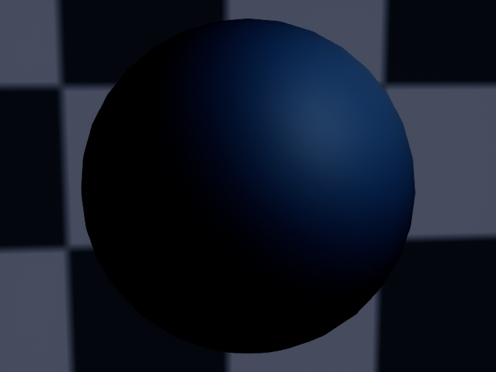 | 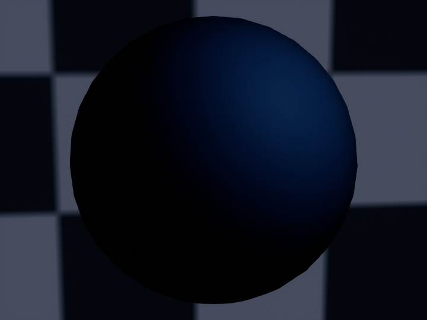 | 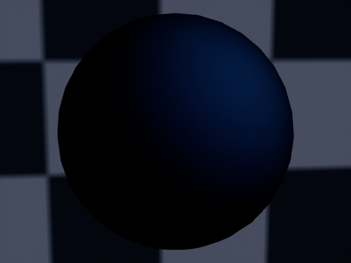 |

## 眼睛、涂层、发光和玻璃

| UE 参数 | 含义与调节效果 | 范围与适用条件 |
|---|---|---|
| `ClearCoat` | 透明涂层的贡献，用于角膜式高光、釉质或塑料表层 | 0—1；仅母材质实际创建 Clear Coat 分支时有效，不是通用透明度 |
| `CoatRoughness` | 涂层本身的粗糙度，与底层 `Roughness` 分开 | 0.02—1；降低通常让涂层高光更集中 |
| `IrisDepth` | 由虹膜遮罩限制的视差 UV 偏移幅度 | 0—0.03，默认 0；不是厘米，不产生眼球几何；需明确的 `iris_mask_Tex` |
| `EmissiveStrength` | 自发光强度，提高会减弱视觉上对外部光照的依赖 | 0—100；虹膜／眼白／眼部高光默认 0.35／0.20／0.30，普通类型通常 0 |
| `EmissiveColor` | 发光 RGB 乘色，与发光来源、遮罩和强度相乘 | 母材质默认白色；最终发光也乘表面 Alpha |
| `IOR` | 玻璃折射率，1 表示与空气接近的无折射差异，增大通常加强偏折 | 半透明玻璃图中的母材质默认 1.45；不是程序材质分析窗口的通用标量，效果受折射路径限制 |

未指定发光图时，眼部三类用基础图及其乘色作为轻微补色来源；指定 `emission_Tex` 后由 `Use_emission` 切换来源。高自发光会让眼睛显得“平”，先小幅调整。普通表面只增大 `EmissiveStrength` 也可能产生整片发光，因为默认发光来源为白图。

半透明玻璃不会因为实例中存在涂层参数名就自动具有不透明 Clear Coat 分支；当前创建逻辑按材质类型和透明模式选择节点。玻璃光追折射的已知限制见 [已知问题](KNOWN_ISSUES.md)。

## MatCap 与水渍

MatCap 是按视空间法线采样的 Sphere 效果，会直接参与基础颜色计算；它不是当前关卡的实时反射。

| UE 参数 | 含义与调节效果 | 范围／默认 |
|---|---|---|
| `UseMatCap` | 是否使用 `sphere_Tex` | 0 关闭、1 开启；默认跟随 PMX 和逐槽选择 |
| `MatCapAdd` | Sphere 的混合方式 | 0 乘算、1 加算；来自 PMX 模式，不是 Sphere 图的 Alpha 开关 |
| `MatCapStrength` | Sphere 参与强度 | 0—2，默认 1；乘算图较暗时会压暗基础色 |
| `WetEnabled` | 水膜、水滴与流痕总控制 | 0—1，默认 0；通常按 0／1 使用，仅皮肤和面部 |
| `WetAmount` | 水渍效果参与量，与总控制相乘 | 0—1，默认 1；总控制为 0 时无效 |
| `WetTiling` | 水渍图案的 UV 重复次数，增大使图案更密、更小 | 0.1—100，默认 8；准备记录可能保存了自动校准值 |
| `WetRotation` | 水渍 UV 图案和法线方向的旋转角度 | -360—360°，默认 0° |
| `WetNormalStrength` | 水滴／流痕法线的凹凸强度 | 0—2，默认 1；不控制湿区粗糙度 |
| `WetRoughness` | 湿区趋近的粗糙度 | 0.02—0.5，默认 0.04；降低通常产生更集中的湿润反射 |

水渍在当前图中同时影响法线、粗糙度、镜面反射和轻微颜色变化。它不添加真正的水滴网格或流体模拟；`WetRotation` 也不会旋转角色模型。

| WetEnabled = 0 | WetEnabled = 1 |
|---|---|
|  |  |

这组只切换水渍总控制，固定 `WetAmount=1`、`WetRoughness=0.04`、`WetNormalStrength=1`。水渍图案、法线及粗糙度共同参与，不能把它理解为纯粹的反光强度开关。

## 贴图、通道和开关

### Texture Parameter

| UE 参数 | 用途 | 数据解释 |
|---|---|---|
| `base_color_Tex` | 原基础色 RGB 与原 Alpha | RGB 按 sRGB 颜色；A 用于表面覆盖 |
| `normal_Tex` | 原基础法线 | Normal，完整 RGB |
| `roughness_Tex`、`metallic_Tex`、`ao_Tex` | 粗糙度、金属度、环境遮蔽 | Linear，选择实际数据通道 |
| `opacity_Tex` | 独立透明遮罩 | Linear；由 `Use_opacity` 控制是否相乘 |
| `emission_Tex`、`emission_mask_Tex` | 发光颜色、发光强度遮罩 | 前者 sRGB，后者 Linear |
| `sphere_Tex` | 原 PMX Sphere／MatCap | sRGB 颜色，由 `UseMatCap` 控制 |
| `direction_Tex` | 头发的切线流向图 | Linear RGB，按向量解码；不是普通灰度方向角 |
| `iris_mask_Tex`、`sss_mask_Tex` | 虹膜视差范围、面部散射范围 | Linear，不能互换 |
| `detail_normal_Tex`、`detail_roughness_Tex` | 程序内置微结构 | 法线／Linear；只在对应材质分支出现 |
| `wet_normal_Tex`、`wet_mask_Tex` | 水渍法线、图案遮罩 | 法线／Linear；皮肤分支使用 |
| `hosiery_mask_Tex` | 丝袜编织覆盖图 | Linear R；半透明丝袜分支使用 |

### Use、Channel、UseAlpha 与 Invert

`Use_roughness`、`Use_metallic`、`Use_ao` 为 0 时采用对应标量，为 1 时采用图中数据。`Use_opacity` 为 1 时将独立遮罩乘入 Alpha；`Use_direction` 为 1 时使用头发流向图。`Use_emission`、`Use_emission_mask`、`Use_sss_mask` 分别控制相应来源或遮罩。它们是图中的标量开关，和左侧“是否覆盖父级值”的勾选框是两回事。并非每张图都有同名 `Use_` 开关；例如基础图与基础法线直接接入。

对 `roughness`、`metallic`、`ao`、`opacity`、`emission_mask`、`iris_mask`、`sss_mask` 这些单值数据，通道读取遵循相同规则：

| 参数形式 | 含义 | 例子 |
|---|---|---|
| `<用途>_Channel` | RGB 的权重；通常用单一通道 | `ao_Channel=(0,1,0,0)` 读取 G |
| `<用途>_UseAlpha` | 1 时读取贴图 A，0 时采用上述 RGB 结果 | `opacity_UseAlpha=1` 读取独立透明图的 A |
| `<用途>_Invert` | 1 时将读取结果变为 `1-值` | 白色代表透明的来源可按需要反转 |

**把 Channel 向量的 A 改为 1，不能代替 UseAlpha。** 当前节点只用 Channel 的 RGB 做点积，Alpha 由独立标量选择。基础色图的 A 则直接参与表面 Alpha，不依赖 `opacity_UseAlpha`。

替换图后还要核对开关与通道。ORM 等打包图不能仅看文件名判断通道；法线也不能把某个单通道直接当完整法线使用。

### sRGB 与源编码

纹理 `sRGB` 控制颜色采样解释；**Source Color Settings → Encoding Override** 声明原始文件的编码，两者用途不同。当前导入规则明确将颜色源设置为 sRGB、法线和数据源设置为 Linear，不改变原图片来补偿亮度。16 位颜色 PNG 的具体处理见 [贴图颜色编码](CHARACTER_MATERIALS.md#贴图颜色编码)。

纹理编辑器的 RGB／A 显示开关、棋盘背景、Mip 级别和预览设置只影响查看方式，不会自动修改材质接线。比较原图与 UE 时，先看同一通道、同一 Mip 与背景。字段说明见 [UE Texture Asset Editor](https://dev.epicgames.com/documentation/en-us/unreal-engine/texture-asset-editor-in-unreal-engine)。

## 透明模式与 Substrate 接线

普通标量 `Opacity` 的范围为 0—1，默认取该槽 PMX 透明度。在新 Alpha 图中，基础表面覆盖为：

```text
基础色图 A × Opacity ×（Use_opacity 开启时的独立透明遮罩）
```

半透明丝袜还会乘入编织、视角和厚度计算，再限制到 0—1。

| UE 设置 | 意义 | 使用时要检查 |
|---|---|---|
| Blend Mode：Opaque | 表面不透明 | 即使接有 Alpha，也不会按 Alpha 镂空 |
| Blend Mode：Masked | 按阈值保留或剔除像素 | 需要最终输出的 Opacity Mask 连接；适合孔洞、蕾丝、发片边缘，不表达连续透明 |
| Opacity Mask Clip Value | Masked 的裁切阈值；提高会剔除更多较低 Alpha 像素 | 不透明模式下不生效；不能用它调出连续透肤 |
| Blend Mode：Translucent | 使用连续透明覆盖 | 需要母图对应透明分支、受光方式和排序；效果不保证与 Opaque 相同 |
| Two Sided | 是否渲染背面 | 不生成厚度，也不自动修复错误法线或重叠面 |
| Shading Model／节点 Single Shading Model | 表面的着色模型，如 Cloth、Clear Coat、Subsurface Profile | Substrate 图要检查实际节点与 Front Material，实例属性不会重建节点图 |
| Translucency Lighting Mode | 半透明表面的受光路径 | 当前程序新建半透明 PBR 母材质使用 Surface ForwardShading 对应模式；实例临时改 Blend Mode 不保证同步 |

`_AM1` 母材质将覆盖值接到最终输出的 **Opacity Mask**，Opaque 父材质也保留这条线，供实例改为 Masked 使用。真正半透明图仍连接 Substrate Opacity。皮肤 Profile 的 Opacity 用于散射，不应被当作同一条表面遮罩线。

下面使用同一张含 Alpha 0、约 0.39、1 和圆孔的程序生成贴图，分别创建三种混合模式的母材质，`Opacity=1`。背景棋盘用于判断是否看见后方，不属于基础色图。

| Opaque | Masked | Translucent（受光异常，待复核） |
|---|---|---|
| 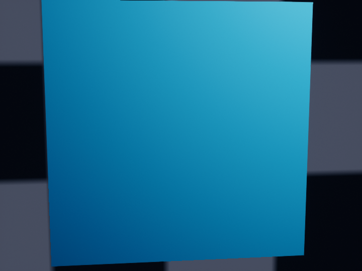 | 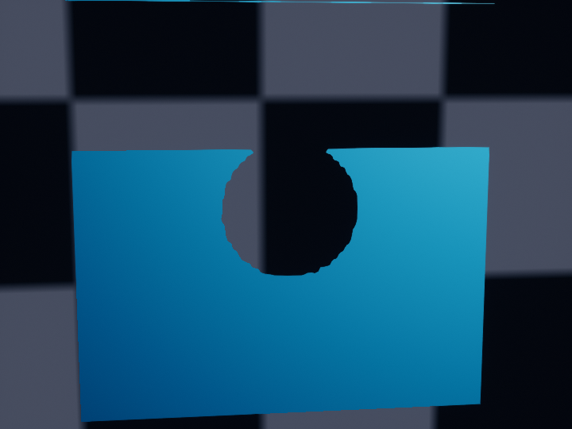 | 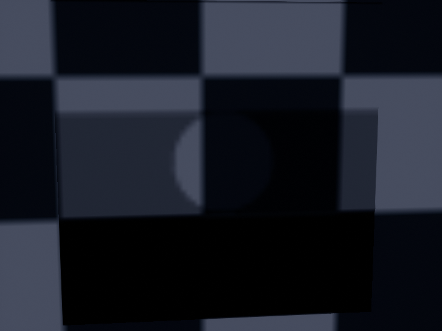 |

左、中图可比较不透明与裁切行为：Masked 中超过阈值的区域仍完整显示。连续透明的定义应看前文与引擎说明；**右图虽可看见中间覆盖区域，但表面颜色异常偏黑，不能作为正常半透明着色示例**。该现象与上面的丝袜例图一起保留为待复核，不把模式切换解释成受光等价。

如果已选 Masked 但预览仍是黑色实心底，先查最终 Opacity Mask 的真实连接和基础图 A，不要只看下拉框。旧母材质未必包含新连接，改混合模式不会自动升级为 `_AM1`。如果半透明受光变平，检查上述受光模式、发光与灯光；不要把“半透明完全不接受光照”当作通用结论。引擎规则见 [Blend Modes](https://dev.epicgames.com/documentation/en-us/unreal-engine/material-blend-modes-in-unreal-engine)、[Lit Translucency](https://dev.epicgames.com/documentation/unreal-engine/lit-translucency-in-unreal-engine) 和 [Substrate](https://dev.epicgames.com/documentation/unreal-engine/overview-of-substrate-materials-in-unreal-engine?application_version=5.8)。

## 灯光、场景材质与输出

| UE 中的位置／参数 | 含义与调节方向 |
|---|---|
| 灯光 Intensity 与 Intensity Units | 实际灯光强度及其单位；同一个数字在 lux、lm、cd 下含义不同，先确认光源类型与单位 |
| Directional Light 的 Source Angle | 光源角尺寸；增大通常让投影更柔和，当前角色柔光预览为 7° |
| Point Light 的 Source Radius | 光源半径，影响反射与阴影形状；本工具按厘米写入 |
| Rect Light 的 Source Width／Height | 矩形光源尺寸，不是曝光；角色预览补光与场景源灯可能使用不同值 |
| SkyLight Intensity | 环境照明强度；当前角色柔光预览为 0.65，场景导入保留自己的来源设置 |
| Post Process／相机的 Exposure Compensation | 画面曝光补偿；在其它条件相同的情况下，+1 EV 对应曝光翻倍，影响整张画面 |
| 相机 Focus Method／Focus Distance | 是否启用对焦及对焦平面的距离；不能用散射参数解决相机失焦 |
| MRQ 的画幅、帧范围、采样与色彩配置 | 最终输出设置；必须核对实际加载的完整预设，视口相似不代表输出一致 |
| `r.VolumetricFog.GridPixelSize`／`r.VolumetricFog.GridSizeZ` | 体积雾栅格精度；减小前者、增大后者通常提高细节与开销，不改变源雾密度的含义 |

有 Blender 场景时，角色柔和阴影只调整工具导入灯的源尺寸／角度，保留其强度、位置及原本更大的源尺寸；单角色预览灯不是所有场景的固定默认。详细操作见 [场景光影](SCENE_APPEARANCE.md)、[显存与画质](MRQ_MEMORY.md) 与 [后台渲染](background_render.md)。

场景材质按 Blender 的有效节点转换，可包含源参数名，不能套用全部角色 PBR 开关。旧通用材质中的 `BaseColor`／`Normal` 也是纹理参数；水面可能暴露 `WaveScale1/2`、`WaveSpeedX1/2`、`WaveSpeedY1/2`、`WaveStrength` 和 `SequenceTime`，分别控制两层波纹密度、UV 速度、法线强度和时间来源。改这些波纹参数不会修改实际水面几何。

ZZZ 和自选母材质沿用自己的契约。例如 ZZZ 的 `Lightmap.A` 参与 MatCap 权重，不是透明度，不能照搬基础图 A 的规则。专用映射见 [角色材质](CHARACTER_MATERIALS.md#zzz_render_pmx)；自选父材质以实际读取到的参数和节点为准。

## 保存、重新应用与排查

在 UE 修改后保存实例及相关 `SSP_`；需要改变组件材质绑定时也保存关卡。母材质会被多个实例共用，改母图前确认影响范围。UE 手工修改不会自动写回程序的逐槽配置。

程序的“应用材质到 UE”与撤销会检查来源、资产和当前绑定。遇到“保留尚未保存的用户编辑”时，先保存并保留手调结果，再决定后续应用范围；**保存只是消除未保存状态，不能保证后续校验允许覆盖已保存的手工编辑**。需要新的转换版本时使用新任务／新输出位置，或复制后在 UE 继续手调，不要关闭冲突保护。

| 现象 | 排查顺序 |
|---|---|
| 参数改了没变化 | 是否覆盖父级 → 是否是角色当前绑定的实例 → 母图是否有该参数与有效分支 → 贴图开关是否替代了标量 |
| 白色变灰、深色变亮 | 纹理源编码与 sRGB → 原图 RGB/A → Tint/MatCap → 灯光、曝光与色彩管理 |
| 黑底没有裁掉 | 原图 A → `Opacity` 与独立遮罩 → Masked → 最终 Opacity Mask → 是否仍为旧母图 |
| 高光太硬 | 固定机位和曝光 → 光源尺寸 → Roughness／Specular → 皮肤 Dual Specular |
| 丝袜调厚后颜色不对 | 当前是否为半透明丝袜母图 → 原 RGB/Tint/MatCap → 实际关卡受光；厚度本身不写黑色 |
| 视口与 MRQ 不同 | 相机、帧、关卡保存状态 → 完整 MRQ 预设 → 曝光／OCIO／渲染管线 |

本页包含独立基础几何的 UE 原生例图及已有角色高光实测图，没有重新运行所有模型和渲染路径的外观验收。不同模型、灯光和渲染路径的结果仍需同条件对照；既有验证范围见 [当前状态](PROJECT_STATUS.md)。
