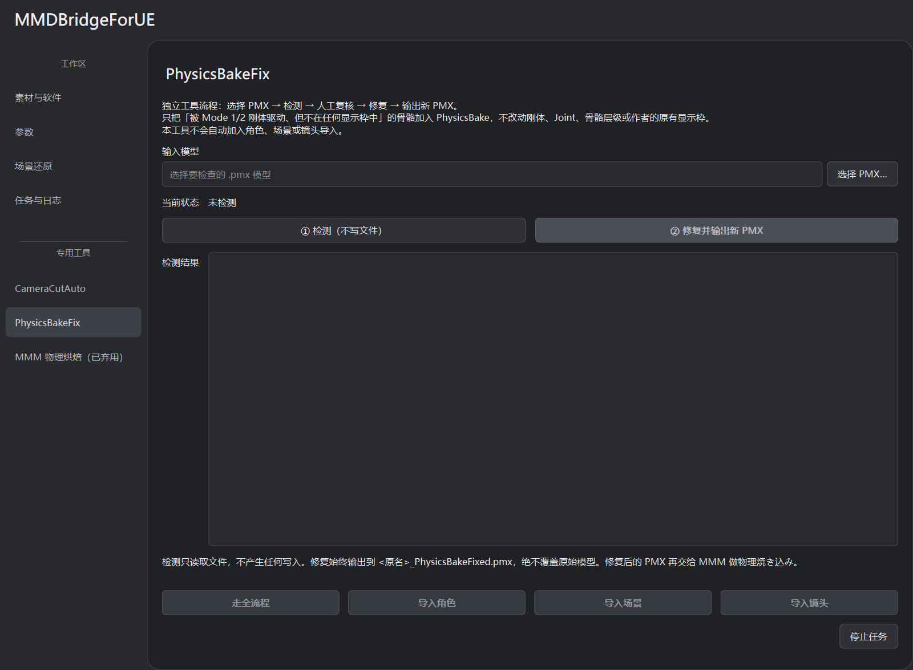
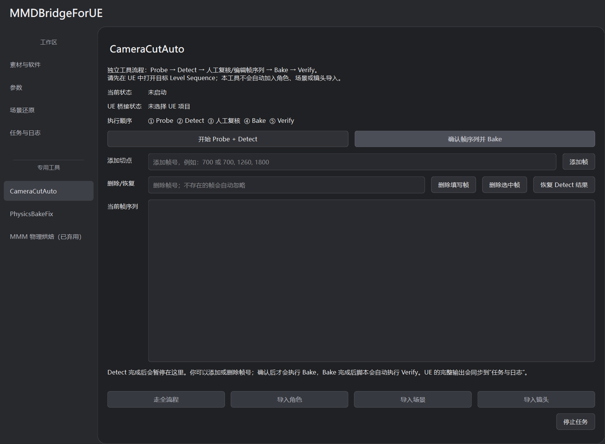
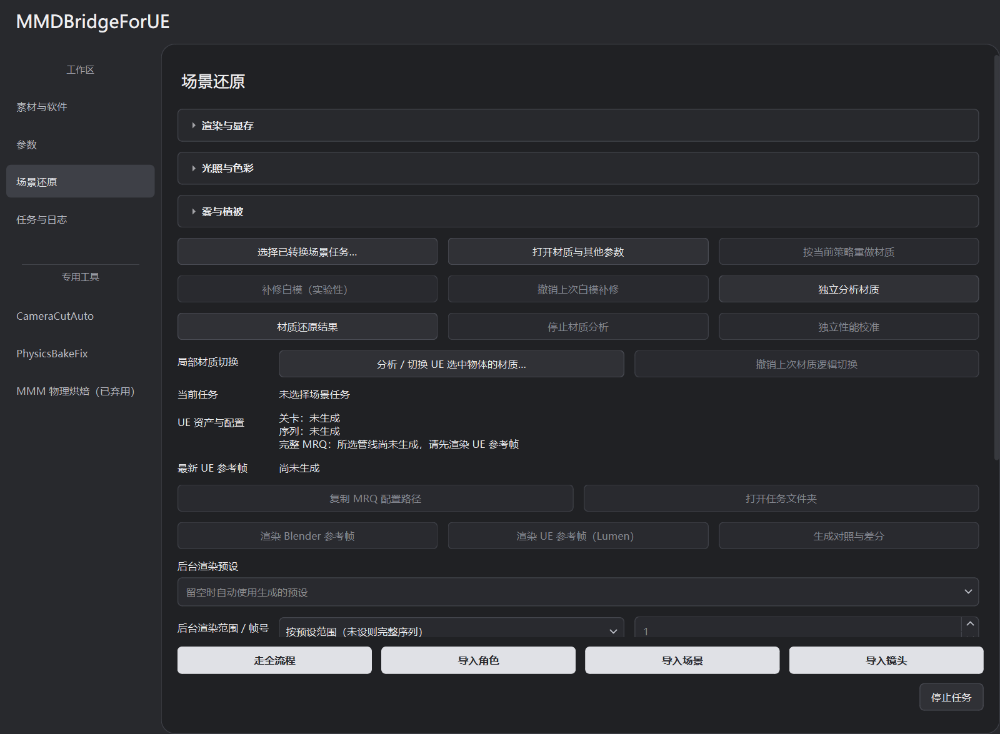

# 日常操作

首次连接工程和全流程步骤见 [快速上手](QUICK_START.md)。

## 选择导入范围

底部按钮指定本次任务的导入范围：

| 按钮 | 必填素材 | 可选素材 |
| --- | --- | --- |
| 走全流程 | PMX、动作 VMD、Blender 场景 | 口型与镜头 VMD |
| 导入角色 | PMX、动作 VMD | 口型 VMD |
| 导入场景 | Blender 场景 | 无 |
| 导入镜头 | 镜头 VMD | 无 |

各流程需配置对应软件与 UE 工程，独立导入仅处理指定素材。默认角色通路是 MMDBridge Mode 1 → 角色双 FBX，场景通路为 USD Stage。

## 配置、路径和任务

**保存配置／载入配置**复用输入和参数；**恢复已有任务**加载任务状态与检查点，继续处理。

每个路径输入独立记住位置。临时中转目录保存任务、恢复点、贴图和导出结果；留空会在桌面新建 `Middle_*`。任务入口是 `MMDBridge_Jobs` 下对应目录的 `job.json`，可用 **打开任务文件夹** 找到。

恢复需要源素材、任务目录和 UE 工程。保留需续跑任务的中转文件；源文件变化后另建任务。

## 参数分组

**参数**页常用区放帧率、导出范围、画幅、场景参考帧、角色和眼睛母材质。其它设置分成“时间、缩放与镜头”“材质转换与适配”“场景导入与碰撞”“角色通路与兼容”。点击标题展开。

场景参考帧用于静态场景求值；动作、口型和镜头偏移以输出帧计算。角色与场景缩放是独立参数。具体材质选择见 [角色材质](CHARACTER_MATERIALS.md)，场景策略见 [USD 场景](USD_SCENE_TUTORIAL.md)。

## 物理骨修复

某些 PMX 的物理骨没有登记到显示枠，可能导致烘焙工具漏掉裙子、头发或饰品的运动。默认 MMDBridge 角色流程会自动检查，必要时补齐任务中 PMX 副本的登记，并回读校验；原模型不覆盖。

需要独立处理时，打开 **PhysicsBakeFix**：

1. 选择 PMX，点 **① 检测（不写文件）**。
2. 查看检出的骨骼和显示枠问题。
3. 点 **② 修复并输出新 PMX**，后续使用生成的 `_PhysicsBakeFixed.pmx`。

修复依据刚体关联和物理模式补齐登记，不修改刚体、Joint 或骨骼层级。独立修复不执行物理烘焙或角色导入。

## 镜头自动切分

一条 VMD 镜头轨道可能包含多个跳切。CameraCutAuto 把确认过的切点组织为 Camera Cuts，减少跳切附近连续插值、时间采样和运动模糊带来的混合画面。

1. 在已连接的 UE 工程中，用 Sequencer 打开目标 Level Sequence。
2. 打开 **CameraCutAuto**，点 **开始 Probe + Detect**。
3. 检查候选帧，按需添加或删除；**恢复 Detect 结果**可还原本次检测列表。
4. 点 **确认帧序列并 Bake**；完成后工具自动 Verify，结果写入日志。

快速运动可能被误判为跳切，请确认候选帧后再 Bake。工具会检查已有的多段 Camera Cuts；Verify 验证轨道结构，渲染效果需检查 MRQ 输出。

## 局部材质切换

对已导入物体的指定材质槽调整表面逻辑，适用于修正材质分类或更改表面表现。支持单选、多选物体和按槽位应用。

1. 在 UE 保存相关关卡和资产，选中一个或多个目标物体。
2. 到 **场景还原**，点 **分析／切换 UE 选中物体的材质…**。
3. 等待工具读取当前选择并匹配转换记录；不必先手动选择任务。
4. 勾选需要修改的材质槽，其余槽位保持原样。
5. 选择表面逻辑并应用，返回 UE 检查画面。

| 表面逻辑 | 常见用途 |
| --- | --- |
| 不透明 | 无需透明的实体表面 |
| 镂空遮罩 | 贴图背景透明、边缘明确的裁切面片 |
| 薄片透光＋镂空 | 同时需要裁切和背面透光的薄表面 |
| 透射折射 | 具有光学透射与折射输入的表面 |

仅支持能匹配转换记录的槽位。切换沿用源材质输入，缺失遮罩或透射数据时，效果可能不符合预期。

**撤销上次材质逻辑切换**恢复这一批次之前的绑定和工具覆盖。后续手动改过绑定时，工具会检查并拒绝盲目覆盖。独立网格体切换成功后会保存当前关卡，应用前先保存自己的其它改动。

## 场景结果与渲染

完成导入后，“场景还原”会显示资产和配置；也可以点 **选择已转换场景任务…** 加载已有 `job.json`。参考图操作见 [场景光影](SCENE_APPEARANCE.md)，不打开编辑器的输出见 [后台渲染](background_render.md)。

**按当前策略重做材质**重新处理材质。修改光影参数后需重新导入场景；切换 Lumen／路径追踪参考渲染时复用原资产。

## 停止与恢复

**停止任务**用于转换，**停止后台渲染**用于后台输出，均保留已写文件。等待进程退出和回执完成后再操作。

转换通过 **恢复已有任务**续跑，后台输出使用 **恢复未完成帧**；均需保留对应任务和输出记录。

已弃用的入口仍保留，使用前查看 [旧流程](LEGACY_FBX.md)。
