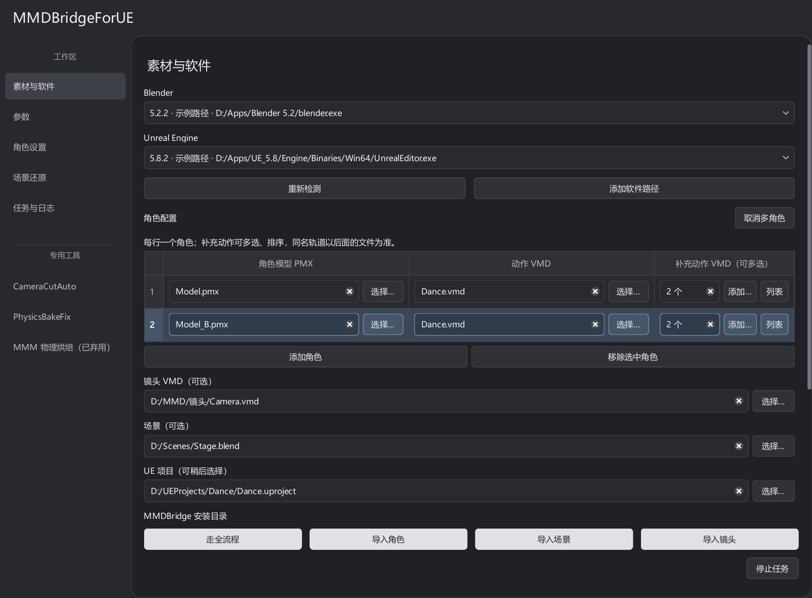
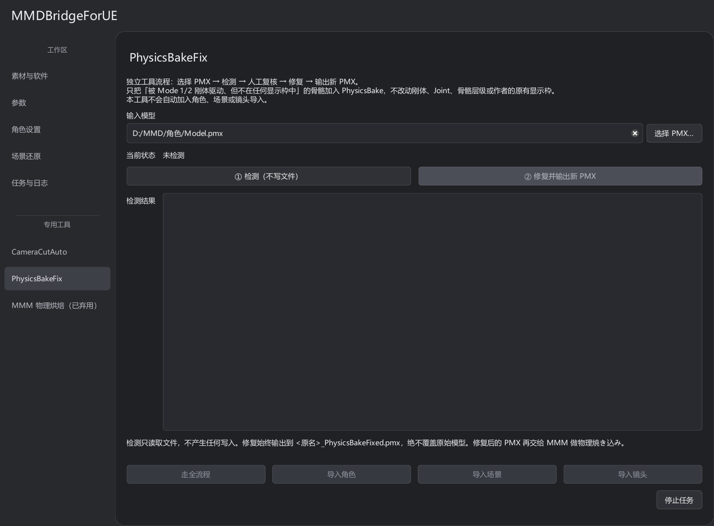
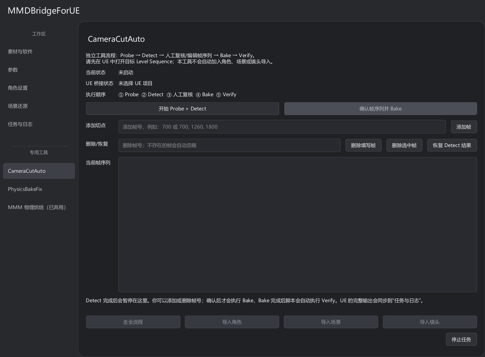
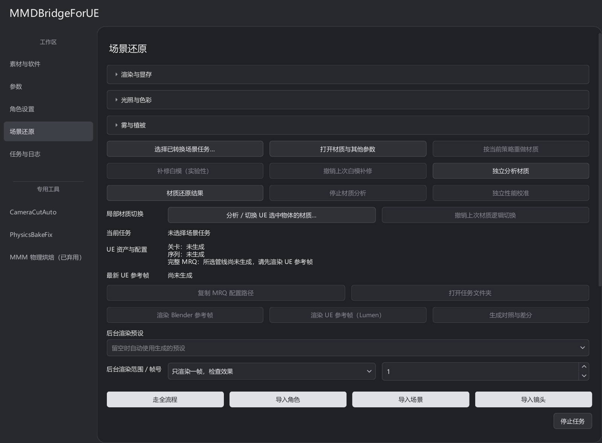

# 日常操作

首次连接工程和全流程步骤见 [快速上手](QUICK_START.md)。

## 选择导入范围

底部按钮指定本次任务的导入范围：

| 按钮 | 必填素材 | 可选素材 |
| --- | --- | --- |
| 走全流程 | 角色、场景、镜头至少一项 | 补充动作及其它模块素材 |
| 导入角色 | PMX、动作 VMD | 多个补充动作 VMD（表情、眼神等） |
| 导入场景 | Blender 场景 | 无 |
| 导入镜头 | 镜头 VMD | 无 |

各流程需配置对应软件与 UE 工程，独立导入仅处理指定素材。默认角色通路是 MMDBridge Mode 1 → 角色双 FBX，场景通路为 USD Stage。

新建默认通路的组合任务会分别处理场景、每个角色和镜头：先完成各模块本地导出，再逐项导入 UE，最后复用成功结果装配关卡与序列。一个模块失败不会阻止其它模块；任务页逐行显示每个模块的状态、进度或诊断与结果目录，双击可打开对应目录；统一日志继续保留完整过程。部分失败或待复核项汇总为 `needs_review`，所有模块失败为 `failed`。主动停止会停止整个组合任务。

恢复组合任务会逐项检查输入、检查点和 UE 回执，复用有效成功结果，重试未完成或失败模块；源素材变化时需新建任务。旧版组合任务仍按原版本恢复。已指定目标工程的组合任务不能中途更换工程。

新任务默认采用“可导入结果继续，问题记为需复核”的导出质量策略。可读取 VMD 的帧范围、轨道缺项，以及 FBX 的形态键或数值差异不会阻断后续 Blender／UE 导入；诊断随清单进入最终 `needs_review` 报告，不标为校验通过。文件损坏、输出缺失或实际导入失败仍终止对应模块。参数页可切换严格策略；缺少该字段的旧任务保留原严格解释。

## 配置、路径和任务

**保存配置／载入配置**复用输入和参数；**恢复已有任务**加载任务状态与检查点，继续处理。

首次启动默认单角色。点击“多角色”后显示全部角色的模型、主动作和补充动作表格；当前模式会自动记录，重启及保存／载入配置都会恢复。切回单角色时保留附加角色配置，但本次任务不会使用它们。

### 补充动作与覆盖顺序

原“表情 VMD”入口现为“补充动作 VMD”。点击“添加…”可多选表情、眼神、口型或其它角色动作；点击“列表”查看文件内容类型、移除文件或调整上下顺序。多角色表格中多个文件显示数量，悬停可查看完整路径及顺序。单角色与多角色的每一行均可独立配置，保存配置和重启会保留各角色的顺序。

主动作先加载，补充动作按列表从上到下合并。**同名骨骼或同名表情整条轨道由最后一个包含该轨道的 VMD 覆盖**，最终只保留该文件中这条轨道的全部关键帧；骨骼与表情即使同名，也属于不同轨道。后面的文件没有某条轨道时，前面的轨道及关键帧完整保留；空区段不会清空其它轨道，显式的零权重关键帧则照常生效。所有文件共用原时间轴，不首尾拼接。

同一文件中同轨道、同帧且记录完全相同的重复关键帧会安全去重，并在 `merge.json` 的 `deduplicated_keys` 中保留诊断；数值不同的重复关键帧仍报错，避免替用户猜测文件内的歧义。

合并文件保存在中转工作区的对应角色任务内：`motion_inputs/merged.vmd`；旁边的 `merge.json` 记录来源、输入顺序、哈希和覆盖轨道。组合任务中每个角色在自己的模块任务内各保存一份。原始 VMD 不修改，自动与手动导出使用同一个合并结果。改变输入内容或顺序后需新建任务，不能复用旧 FBX。

补充动作列表支持 MMDBridge Mode 1 和旧 Blender / FBX 通路。Mode 1 保持 30fps、动作及补充偏移为 0；旧 Blender / FBX 的补充文件共用原口型偏移，其与主动作的偏移差须能对应整数原始 VMD 帧，且偏移后不能出现负帧。未包含列表字段的已创建旧任务保留原主动作／表情双输入处理；载入旧配置后新建任务会按当前列表规则合并。MMD2Unreal 保留原交互入口，不使用补充动作列表。

多角色导入 UE 时，各角色的材质和描边实例放在对应的 `Characters/C_0001/Materials`、`Characters/C_0002/Materials` 等目录，避免同名材质互相覆盖；原 PMX／FBX 槽名保留用于分配。适配母材质和可共享资源继续复用。恢复旧任务时会为角色生成分目录实例，旧公共材质保留。

角色缺少 Physics Asset 时，工具使用 UE 官方接口生成随骨骼更新的包围盒来源，避免角色通过子骨骼移动后仍按原点边界剔除；已有 Physics Asset 保留，烘焙角色不启用 UE 物理模拟。透明判定区分遮罩软边与连续半透明，主材质和描边使用同一模式。恢复旧任务时会从角色还原点升级 Alpha 数据，复用已完成的 VMD 与 FBX，再重建过期材质实例。

每个路径输入独立记住位置。临时中转目录保存任务、恢复点、贴图和导出结果；留空会在桌面新建 `Middle_*`。任务入口是 `MMDBridge_Jobs` 下对应目录的 `job.json`，可用 **打开任务文件夹** 找到。

恢复需要源素材、任务目录和 UE 工程。保留需续跑任务的中转文件；源文件变化后另建任务。

## 参数分组

左侧 **工作区** 中，**角色设置** 与 **场景还原** 同级。

**角色设置**页集中放角色和眼睛母材质、材质适配配置、分析与配置材质、皮肤散射、柔和阴影和几何处理。动作及补充动作偏移、历史 FBX 缩放放在“角色动作与缩放”；角色导入通路和母材质配置目录放在“角色通路与兼容”。

**参数**页保留帧率、导出范围、画幅、场景参考帧和通用导出质量处理，其它设置分成“时间、缩放与镜头”“材质转换与适配”“场景导入与碰撞”。点击标题展开。页面调整不改变配置字段，已有配置和任务仍可载入；两页的“恢复默认设置”均恢复转换参数，保留素材和软件路径。

所有数值框、下拉选择框和滑块均不通过滚轮改值，包括获得焦点后的控件、材质分析弹窗和动态创建的表格编辑器。使用键盘、点击选项或步进按钮调整；滚轮仍可滚动页面、表格和下拉列表。

自选角色母材质的新任务，在“分析与配置材质…”中读取 UE 的 Texture Parameter，手动选择基础色、Sphere、Toon 或补选贴图的对应关系；未指定则继承 UE 父材质默认。统一规则、逐槽覆盖、导出／载入和独立应用／撤销见[角色材质](CHARACTER_MATERIALS.md#自定义母材质)。其它材质预设及场景匹配规则保持原样。

场景参考帧用于静态场景求值；动作、补充动作和镜头偏移以输出帧计算。角色与场景缩放是独立参数。具体材质选择见 [角色材质](CHARACTER_MATERIALS.md)，场景策略见 [USD 场景](USD_SCENE_TUTORIAL.md)。

导入后在 UE 中修改材质、透明度、皮肤 Profile 或灯光时，见 [UE 参数指南](UE_PARAMETERS.md)。UE 中的手调不会自动写回程序配置；后续应用和撤销仍会检查手工编辑冲突。

## 物理骨修复

某些 PMX 的物理骨没有登记到显示枠，可能导致烘焙工具漏掉裙子、头发或饰品的运动。默认 MMDBridge 角色流程会自动检查，必要时补齐任务中 PMX 副本的登记，并回读校验；原模型不覆盖。

需要独立处理时，打开 **PhysicsBakeFix**：

1. 选择 PMX，点 **① 检测（不写文件）**。
2. 查看检出的骨骼和显示枠问题。
3. 点 **② 修复并输出新 PMX**，后续使用生成的 `_PhysicsBakeFixed.pmx`。

修复依据刚体关联和物理模式补齐登记，不修改刚体、Joint 或骨骼层级。独立修复不执行物理烘焙或角色导入。

独立 VMD 镜头及组合任务中的采样镜头按输出画幅匹配 Blender 的传感器适配；VMD 未提供景深时关闭 UE 默认手动对焦，避免无来源的近景虚化。镜头运动和焦距仍使用原动作逐帧数据。

## 镜头自动切分

一条 VMD 镜头轨道可能包含多个跳切。CameraCutAuto 把确认过的切点组织为 Camera Cuts，减少跳切附近连续插值、时间采样和运动模糊带来的混合画面。

1. 在已连接的 UE 工程中，用 Sequencer 打开目标 Level Sequence。
2. 打开 **CameraCutAuto**，点 **开始 Probe + Detect**。工具使用当前关卡；旧名称未命中时，从当前序列识别唯一的动画相机，多相机有歧义时会停止并提示。
3. 检查候选帧，按需添加或删除；**恢复 Detect 结果**可还原本次检测列表。
4. 点 **确认帧序列并 Bake**；完成后工具自动 Verify，结果写入日志。

快速运动可能被误判为跳切，请确认候选帧后再 Bake。工具会检查已有的多段 Camera Cuts；Verify 验证轨道结构，渲染效果需检查 MRQ 输出。

旧脚本生成的相机归入大纲和 Sequencer 的“切分镜头”文件夹，保留手工文件夹；复核包含切前半帧和其它子帧采样。既有切分结果不自动修改。

## 局部材质切换

对已导入物体的指定材质槽调整表面逻辑，适用于修正材质分类或更改表面表现。支持单选、多选物体和按槽位应用。

1. 在 UE 保存相关关卡和资产，选中一个或多个目标物体。
2. 到 **场景还原**，点 **分析／切换 UE 选中物体的材质…**。
3. 等待工具读取当前选择并匹配转换记录；不必先手动选择任务。
4. 勾选需要修改的材质槽，其余槽位保持原样。
5. 选择表面逻辑并应用，返回 UE 检查画面。

| 表面逻辑 | 常见用途 |
| --- | --- |
| 不透明 | 无需透明的实体表面 |
| 镂空遮罩 | 贴图背景透明、边缘明确的裁切面片 |
| 薄片透光＋镂空 | 同时需要裁切和背面透光的薄表面 |
| 透射折射 | 具有光学透射与折射输入的表面 |

仅支持能匹配转换记录的槽位。切换沿用源材质输入，缺失遮罩或透射数据时，效果可能不符合预期。

**撤销上次材质逻辑切换**恢复这一批次之前的绑定和工具覆盖。后续手动改过绑定或 USD 根层时，工具会检查并拒绝覆盖。独立网格体与 USD 场景切换、撤销成功后均保存当前关卡；应用前先保存自己的其它改动。资产路径较长时，新候选材质使用任务资产根内的短目录，不移动已有资产。

## 场景结果与渲染

完成导入后，“场景还原”会显示资产和配置；也可以点 **选择已转换场景任务…** 加载已有 `job.json`。参考图操作见 [场景光影](SCENE_APPEARANCE.md)，不打开编辑器的输出见 [后台渲染](background_render.md)。

**按当前策略重做材质**重新处理材质。修改光影参数后需重新导入场景；切换 Lumen／路径追踪参考渲染时复用原资产。

参考帧选择的 UE 显存档位会保存到任务，但不影响 Blender 冻结几何检查点。旧检查点仅因该档位不同也可复用；素材、几何和 Blender 版本等其它身份校验继续生效。

## 停止与恢复

**停止任务**用于转换，**停止后台渲染**用于后台输出，均保留已写文件。等待进程退出和回执完成后再操作。

转换通过 **恢复已有任务**续跑，后台输出使用 **恢复未完成帧**；均需保留对应任务和输出记录。

已弃用的入口仍保留，使用前查看 [旧流程](LEGACY_FBX.md)。
