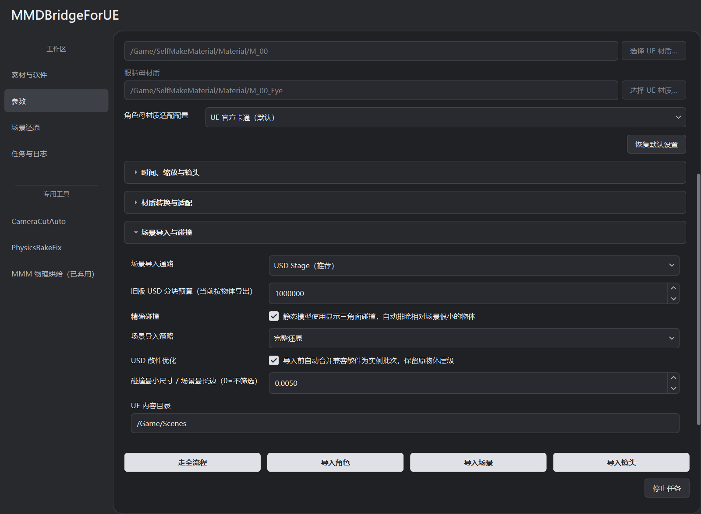

# USD 场景转换

读取 Blender 指定参考帧的最终结果，生成分层 USD、材质数据和贴图，并导入 UE 供后续编辑与渲染。

## 导入步骤

1. 先在 Blender 打开源 `.blend`，确认贴图、实例和模拟缓存正常。
2. 在“素材与软件”选择 `.blend`、Blender、UE 和目标工程。
3. “参数”中确认 **场景参考帧**；“场景导入与碰撞”里保持 **USD Stage**。
4. 首次保持默认材质策略和新增烘焙分辨率，连接工程后点 **导入场景**。
5. 到任务日志查看生成的关卡、资产与失败／需复核项，再在 UE 检查结果。

源 `.blend` 不覆盖保存。导出的 USD 与贴图有独立任务目录，运行副本放入目标 UE 内容目录。

## 参考帧与几何求值

修改器、Geometry Nodes、实例和已缓存模拟按参考帧求值，转换的是当时渲染可见的最终几何。可对应的父层级和世界变换保留。

此流程导出参考帧的静态结果，不完整迁移 Blender 动画、模拟或第三方效果。缓存缺失、求值失败及无几何输出的对象会记录在报告中。

## 材质转换

“参数 → 材质转换与适配”里，**场景材质策略**决定可用的转换方式：

| 策略 | 用途 |
| --- | --- |
| 自动 | 首次导入；按有效输入选择节点、局部烘焙或贴图 |
| 优先 UE 节点 | 希望保留已支持节点的计算关系；不能转换的图会报告限制 |
| 混合还原 | 保留可转换部分，只烘焙无法对应的字段 |
| 完整烘焙 | 适合静态贴图近似的材质；不能等价保存所有视角、光照或动画效果 |

**材质工作流**默认 `legacy_main_v1`，使用当前主转换流程；`semantic_plan_v1` 按依赖和表面特征生成计划，用于已有任务兼容。新任务建议保留默认值。角色 Toon／ZZZ 在角色适配配置中单独选择。

基础贴图沿用源 UV；额外烘焙按需要建立 UV 或投影。“新增材质烘焙分辨率”默认 2K，只影响新烘焙，不会把全部源图重新缩放。Alpha 裁切和光学透射分别判断。

在 Blender 的对象或材质自定义属性里，可用 `mmd_bridge_material_strategy=auto/nodes/hybrid/bake` 明确覆盖策略。复杂闭包、位移和受光照或视角影响的节点仍需比较画面。

已导入物体的表面逻辑需要调整时，可用 [局部材质切换](USAGE.md#局部材质切换) 修改指定槽位。

## 实例和碰撞

**USD 散件优化**把兼容的重复散件组织为实例批次，减少大量独立对象的负担。需要逐个编辑散件时可关闭优化。镜像、剪切、单独隐藏、动画或特殊自定义属性可能使某些对象保持独立。

**精确碰撞**按显示三角面生成，默认排除相对场景尺寸很小的物体。“碰撞最小尺寸 / 场景最长边”为 0 时取消尺寸过滤。

| Blender 对象自定义属性 | 作用 |
| --- | --- |
| `mmd_bridge_collision=exact` | 强制保留该对象的精确碰撞 |
| `mmd_bridge_collision=none` | 排除该对象碰撞 |

导入后用 UE 碰撞显示和实际查询检查薄片、小物体和实例。大量三角面碰撞会增加资源和运行开销。

**渲染减负**策略侧重实例批次，减少精细碰撞和网格体积负担，不会因此关闭硬件光追或光追阴影。程序纹理细节需复核。

## 生成层与手工修改

`Scene.usda` 是用户根层，工具生成的几何、材质和贴图分开保存。`Geometry.usda`、`ToolMaterials.usda` 及其引用目录在刷新时可能替换；长期手工覆盖应放在用户层，不要只改工具生成层。

重导出或材质重建前保存 UE 改动。停止后保留完成的文件与检查点；源素材变化时建立新任务。任务恢复见 [日常操作](USAGE.md#停止与恢复)。

灯光、雾与参考帧比较见 [场景光影](SCENE_APPEARANCE.md)。
