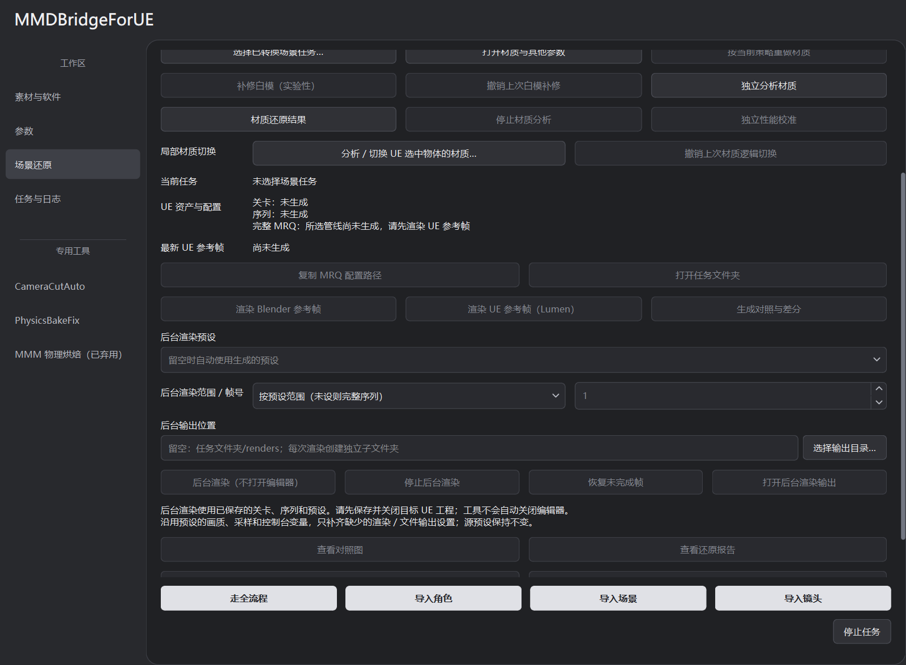

# 后台渲染

通过 UE 已保存的关卡、序列和 MRQ 预设后台输出，无需打开编辑器，仍需 GPU 与 UE 运行资源。

## 操作步骤

1. 在 UE 保存关卡、Level Sequence 和 MRQ 预设，关闭目标工程的编辑器。
2. 到 **场景还原**，加载已转换场景任务的 `job.json`。
3. **后台渲染预设**可留空，使用该管线已生成的任务预设；也可选择已有资产或粘贴“复制引用”。
4. 第一次选择 **只渲染一帧，检查效果**；确认后再用 **按预设范围**。
5. 可选输出父目录，点击 **后台渲染（不打开编辑器）**。



留空预设时优先取当前管线对应项，再取任务通用预设。预设在导入或参考帧配置阶段生成；任务里没有预设时会要求先完成导入或手动指定，后台入口不会新建预设资产。

输出目录每次单独创建。留空父目录时位于任务的 `renders/Render_…/output`。页面提供进度、输出和日志入口。

## 预设与输出设置

工具使用预设的内存副本，保留画质、采样、抗锯齿、颜色、控制台变量及已有的渲染／输出设置；仅补齐缺少的渲染 Pass 和 PNG 输出。输出位置改为本次目录，单帧模式临时覆盖范围，源预设不保存改写。

“按预设范围”保留预设自定义范围，预设未设范围时使用完整序列。要改变序列内容或材质，先在 UE 编辑并保存。

## 停止与恢复

**停止后台渲染**停止本次启动的渲染进程并保留已写文件。关闭工具也会停止后台任务；已有 UE 编辑器需手动关闭。

**恢复未完成帧**续跑已记录的后台任务，恢复前核对任务、预设与输出目录。转换任务使用 **恢复已有任务**。

任务保存启动计划、运行状态、结果回执、`unreal.log` 和 `launcher.log`。完成判断需要 UE 回执、正常退出、新输出，以及没有已知镜头绑定失败或 GPU 崩溃。

## 实际执行方式

程序启动 `UnrealEditor-Cmd.exe -game -RenderOffscreen`，由 UE MRQ InProcess Executor 输出。关闭编辑器可减少重复加载场景的开销；显存占用取决于场景与预设。

渲染自动显存保护默认关闭（`render_vram_guard_enabled=false`），仍记录占用与峰值。显式启用该字段后才按阈值保护；导入／导出有独立策略。

## 命令行

源码环境可使用：

```powershell
.\.venv\Scripts\python.exe scripts\render_ue_standalone.py "D:\你的任务目录" --preset "/Game/Render/MRQ_MyPreset" --frame 1 --run
```

不加 `--run` 只生成计划。省略 `--preset` 使用任务保存的管线预设或通用预设，缺失时明确报错；省略 `--frame` 沿用预设范围。`--output` 指定输出父目录，`--profile` 只选择任务已有的显存策略预设，不改写源资产。

相关设置见 [显存与画质](MRQ_MEMORY.md)。
